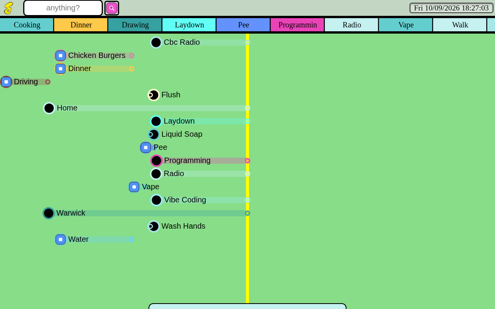
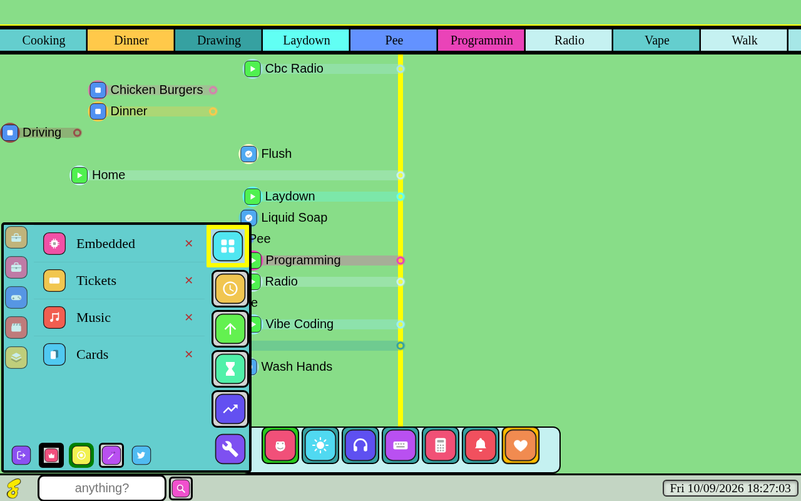
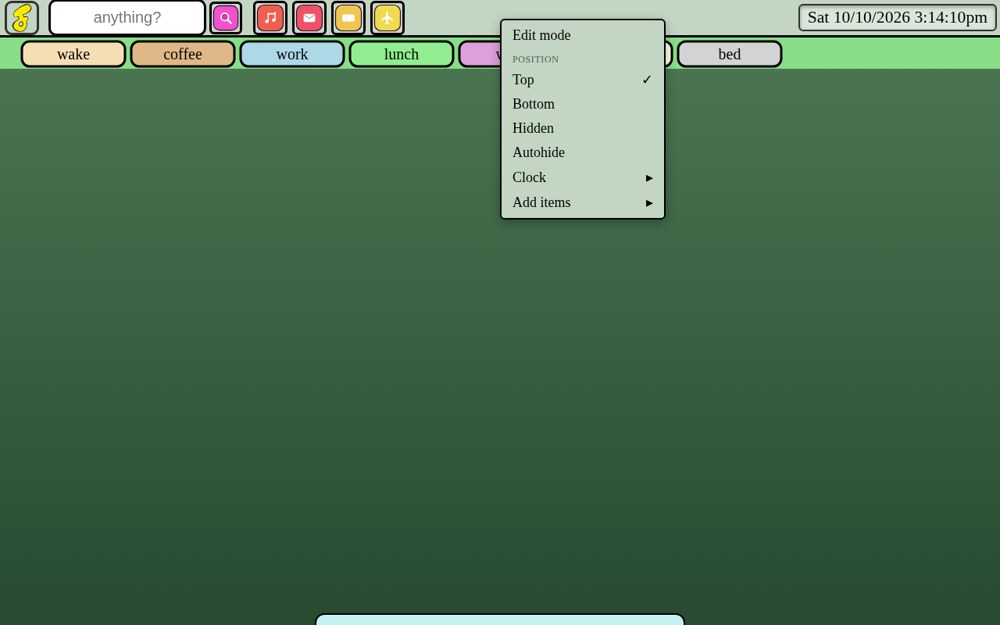
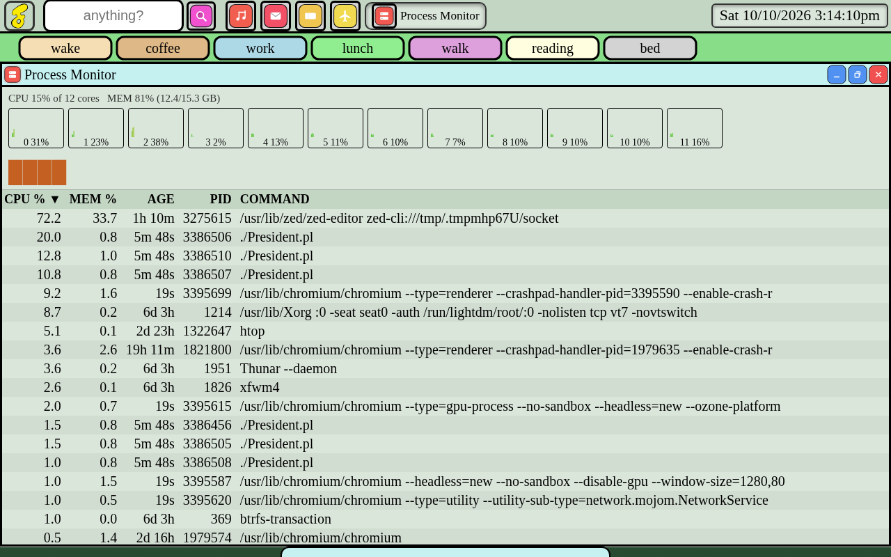
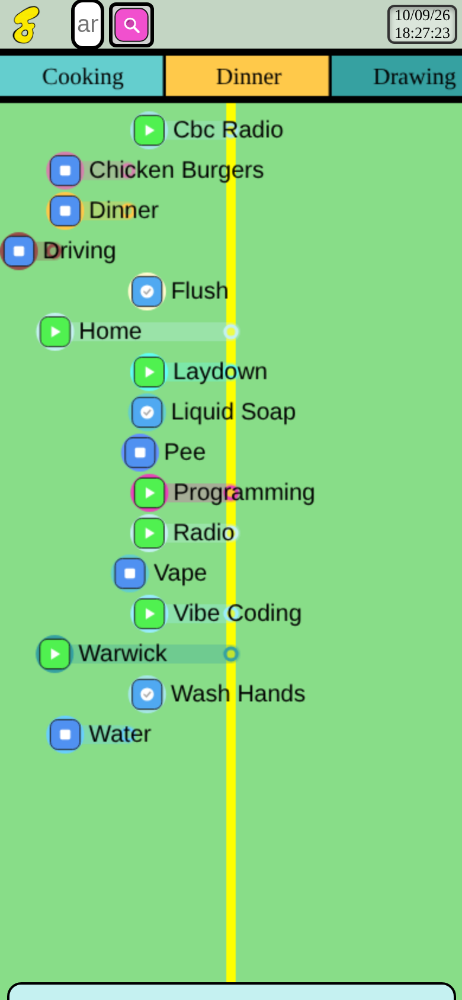

# JawnOS

**A personal, self-hosted operating environment.**

JawnOS is a long-running personal software project by Jon ("Jawn") Ferwerda. It turns a single
Perl web server into a browser-based command centre — a desktop-like environment that gathers
the things one person actually does with a computer: files and media, appointments and tasks,
budgets and invoices, inventory and mail, notes and location history, AI assistance, and a small
fleet of handheld and wearable devices.

It is not an operating system in the kernel sense, but a self-hosted personal environment that
runs as an ordinary application and presents itself through the browser. It integrates natively
with the **LilyGo T-Watch S3**, the **LilyGo T-Deck (Plus, with GPS)** and the **Raspberry Pi
Pico 2W**, and it can reach into the physical world through home-automation hardware and network
devices.

JawnOS is under active development, and "finished" remains a moving target — but it is genuinely
useful in the meantime, and I hope it is of some use to you too.

## Features

### The desktop

JawnOS is a windowed desktop that lives in a browser tab. Windows open, stack, minimise,
maximise, snap to half the screen and enter a move mode from their own drop-down menu, and the
furniture around them is largely user-defined:

- **A configurable taskbar.** The bar is an ordered list of slots — the open windows, the clock,
  the start button, the search box and any pinned apps or keyboards — that can be rearranged in
  an edit mode. Right-clicking (or long-pressing on touch) opens a context menu for the bar, its
  tiles and each window; the bar can be shown, hidden or set to auto-hide, and the clock offers
  12- or 24-hour time and a choice of time zone.
- **A start menu** with a recently used list, a category rail, and an optional search box that
  can ride the menu, the taskbar or the dock.
- **A dock** that can be placed on any edge and slides away when idle.
- **A "clothesline"** — a rail along the top of the screen that hangs the routines and rituals
  that belong at the current hour, in the order they usually happen.
- **Global display zoom** (20%–200%) and adjustable bar heights, so the interface can be scaled
  for a phone, a tablet or a large display.
- **Fourteen selectable icon sets**, with the original hand-drawn artwork as the default.

### Files, media & creation

- **Files & folders** — browse with a full right-click menu (new file and folder, rename, open,
  open with, copy/cut/paste, delete, shred, archive and properties), and play video and audio or
  view photos through an on-the-fly thumbnailer backed by a disk cache. Files can be **sealed** —
  encrypted with your credentials under a name of their own — and opened again from the same
  menu, with the long jobs running in the background and reporting their progress. Moving,
  sealing, opening or deleting a file carries the appointments, mail attachments and store
  entries that named it along with it.
- **Drawing (the marker)** — a layered paint board with pencil, paintbrush, spray, fill and
  matching erase tools, undo/redo, and zoom and pan. It reads stylus pressure, ignores your palm
  on a tablet, and autosaves so a refresh does not lose a painting.
- **Music and studio** — a multitrack studio with takes, crossfades, waveform clips and a
  pedalboard routed onto channels, alongside a synthesiser and a music player.
- **Text, code and shell** — a rich text editor with variables that can answer for an
  appointment; a colour-coded IDE for Perl, JavaScript, HTML and templates; a web browser; and a
  terminal.

### Appointments, tasks & routines

- **Appointments & scheduling** — a full calendaring system with alarms, recurring
  appointments, reminders and calendar export.
- **Tasks** — nested checklists whose items carry a colour, a priority, a renewal interval and a
  budget, and that can record the matching appointment when you tick one off.
- **The wardrobe (clothesline)** — apps and routines are "hung" on the rail for the hours they
  belong to, with automatic hanging of the routines the history shows you actually perform.

### Money, stock & documents

- **Budgeting** — a statement, budgets, a document ledger of invoices and quotes, and a daily
  sheet, all drawn from the same transaction history.
- **Store & invoicing** — a store of items, models and options that each carry their own prices,
  with quotes and invoices that print to a white, house-styled paper and can be delivered by
  email. Recording a payment against a document updates its balance and closes it when the
  balance reaches zero; deleting that transaction reopens it.
- **Warehouse & stock** — money and goods tracked per place: what is where and how much of it,
  packaging that carries real quantities (a carton of twelve, a box of nails by weight) and
  shelf life so expired stock is swept up on its own, a journal of every stock movement and its
  reason, and a **moves ledger** that folds stock and money into one signed list.
- **Notes & documents** — note-taking, document scanning, OCR (Tesseract), barcode/QR scanning
  (zbar) and PDF rendering (WeasyPrint).

### Communication, location & assistance

- **Mail & messages** — email over IMAP/SMTP, SMS, and an internal message and paper-route
  system, with mail that arrives straight on the desktop.
- **Location & activity** — location logging, travel history, distance and speed calculations,
  and a "father time" activity clock.
- **AI assistance** — chat and image generation through local [Ollama](https://ollama.com)
  models and Cloudflare Workers AI, plus speech (espeak) and transcription (whisper.cpp).
- **Evaluation** — a model-backed appraisal of any app's activity, run on demand or nightly,
  that reads what the app is and what it has been doing, weighs day, week, month and year
  together, and leaves a report beside the app with a headline and links to everything it names.

### System, security & devices

- **System & monitoring** — a **Process Monitor** with live CPU and memory readings, per-core
  graphs and a sortable process list; network **device discovery** with a ping/`/device_query`
  scan; backup and restore; and a utility controller for the background chores.
- **Utilities & security** — password and pseudonym generation, QR codes, encryption helpers,
  screen locking and a keyring-style secret store.
- **Devices & firmware** — first-class support for the T-Watch, T-Deck and Pico 2W, with remote
  control, a Bluetooth Low Energy bridge, SSH tunnelling, and encrypted sync between machines.

## Screenshots

**The desktop.** The clothesline runs along the top, hanging the routines that belong at the
current hour; the taskbar and the dock share the edges.



**The start menu.** It opens on the recent apps, with a category rail for the whole catalogue and
a search that can ride the menu, the taskbar or the dock.



**The taskbar's context menu.** From here the bar is rearranged, repositioned, set to auto-hide
and repopulated with pinned apps and keyboards; the clock's format and time zone live here too.



**Process Monitor.** Live CPU and memory readings, per-core graphs and a sortable process list.



**On a phone.** The bars can be moved, hidden or set to auto-hide, and the interface scales to
the screen.



## How it's built

- **Backend:** Perl, using [Mojolicious::Lite](https://mojolicious.org) as the web framework.
  `jawn` is the launcher — it runs `President.pl` in a PTY and restarts it if it dies — and
  `President.pl` is the Mojolicious app that boots the servers, workers and sockets.
- **Data:** SQLite (via `Mojo::SQLite` / `SQL::Abstract`). Most internal message passing between
  processes is [Sereal](https://metacpan.org/pod/Sereal)-encoded over Unix sockets, and
  [Minion](https://metacpan.org/pod/Minion) carries the background jobs.
- **Processes:** the app runs as a set of purpose-specific servers. `President.pl` starts a dock
  server, a WebSocket server, the main prefork server, an alarm worker, the watch and teletype
  servers, each identified by `PURPOSE` and each loading the module that suits it. In development
  they run under Morbo for hot reloading; in production they run as prefork workers.
- **Real-time:** WebSockets push updates to the browser so windows, notifications and status stay
  live without polling.
- **Front end:** Embedded-Perl (`.ep`) templates in `templates/`, rendered into a jQuery-driven
  "desktop in a browser" UI in `public/`.
- **Firmware:** Arduino sketches under `jp/`, `jt/` and `jw/` for the handheld and wearable
  devices.

### Repository layout

| Path | What it is |
| --- | --- |
| `jawn` | Launcher/supervisor — starts `President.pl` in a PTY and restarts it on crash |
| `President.pl` | The Mojolicious app — boots the servers, workers and sockets |
| `Manager.pl` | The main application: routes and the bulk of the features |
| `gb.pl` | Global state shared across the app |
| `subroutines.pl` | Shared helper library |
| `Websocket.pl` | WebSocket server and live updates |
| `Alarm.pl`, `Music.pl`, `pen.pl`, `teletype.pl`, `watch.pl`, `hooks.pl` | Feature modules (alarms, music, notes, terminals, smartwatch, device hooks) |
| `templates/` | Embedded-Perl page templates |
| `public/` | Front-end JavaScript, CSS and images (including the icon sets in `public/icons/sets/`) |
| `jp/`, `jt/`, `jw/` | Device firmware (Pico 2W, T-Deck, T-Watch) |
| `scripts/` | Supporting scripts — the dependency checker, the first-run wizard, the process killer, the BLE bridge and the store invoice driver |
| `database/` | `schema.sql` (used to build a fresh database) and a starting encrypted database |

## Requirements

- Perl 5 with the CPAN modules listed in the installation section below
  (`Mojolicious`, `Mojo::SQLite`, `Minion`, `Sereal`, `Crypt::Simple` and friends).
- A handful of command-line tools: `ffmpeg`, `imagemagick`, `tesseract`, `sqlite3`, `qrencode`,
  `zbar`, `espeak`, `curl`, `rsync`, `openssl`, `sshpass` and `autossh` (see below).
- Optional, for the full feature set: Python `weasyprint` (PDF rendering), `ollama` (local AI
  models), and a `whisper.cpp` build with the base model (audio transcription).
- Optional, for the Linux desktop app (`desktop/`, the phone's dashboard and BLE bridge on a
  computer): `python3-gi`, `python3-dbus`, BlueZ, **WebKitGTK 4.1** (the embedded view) and the
  **GStreamer** plugin set with a VA-API plugin for GPU video decode — see
  [`desktop/README.md`](desktop/README.md#media-and-video).

You do not have to install any of this by hand. The first time you run `./jawn` it checks for
every dependency and offers to install whatever is missing. The per-platform sections below are
the do-it-yourself fallback.

## Installation

The first run of `./jawn` drives the whole install: it gets missing dependencies, then opens a web
wizard that writes `config.json` and builds you an encrypted database (see
[First run](#first-run)). If you would rather install the dependencies yourself first, the
per-platform instructions below will do it — the wizard still handles the config and database.

To check (and optionally install) dependencies on their own:

```
perl scripts/jawnos_deps.pl           # report, then offer to install
perl scripts/jawnos_deps.pl --report  # report only; exits non-zero if anything is missing
perl scripts/jawnos_deps.pl --sh      # print the install commands as a shell script
```

### Android (Termux)

Install F-Droid, then install **Termux** and **Termux:api** from it.

In Termux:

```
termux-setup-storage

pkg install openssh termux-api espeak build-essential \
perl tesseract imagemagick zip sqlite sshpass openssh \
curl sox iproute2 libqrencode rsync zbar ffmpeg tmux \
autossh android-tools ollama termux-services

cpan App::cpanminus

cpanm Net::SSLeay

cpanm --notest --force Mojolicious::Lite \
 Net::SSLeay CryptX \
 WWW::Mechanize Time::Piece Time::Duration \
 Date::Parse Hash::Merge Encode Data::Dumper \
 File::Find File::Slurp Number::Format \
 SQL::Abstract Mojo::SQLite Data::UUID \
 Mojolicious::Plugin::RenderFile \
 LWP::UserAgent Crypt::Simple File::Type \
 HTML::Strip URI::Encode LWP::Protocol::https \
 URI::Escape MIME::Base64 Math::Trig List::Util \
 Net::IMAP::Client MIME::Parser \
 Email::Stuffer Authen::SASL \
 Minion Minion::Backend::SQLite Mojo::IOLoop::ReadWriteFork \
 Sereal::Encoder WebService::Ollama

pip install weasyprint
```

Activate developer settings: go to **Settings → About Device → Software Information** and tap
**Build Number** seven times. In **Developer options**, turn on **Wireless debugging**, tap it,
then pair the device:

```
adb pair ip:port
adb connect ip:port
adb shell settings put global settings_enable_monitor_phantom_procs 0
adb shell settings put global max_phantom_processes 2147483647
```

```
cd jawnos

chmod +x jawn President.pl

./jawn
```

### Debian

```
sudo apt update; sudo apt upgrade;
sudo apt install lib32z1-dev cpanminus \
ssh espeak build-essential zip openssl libssl-dev \
perl tesseract-ocr imagemagick sqlite3 sshpass \
ssh curl sox iproute2 qrencode rsync ffmpeg libbarcode-zbar-perl \
tmux weasyprint autossh net-tools ollama

# For the Linux desktop app (desktop/): the embedded view and smooth video
# (gstreamer1.0-vaapi is the GPU decode plugin; add your GPU's VA driver too).
sudo apt install python3-gi python3-dbus bluez gir1.2-webkit2-4.1 \
gstreamer1.0-plugins-base gstreamer1.0-plugins-good gstreamer1.0-plugins-bad \
gstreamer1.0-plugins-ugly gstreamer1.0-libav gstreamer1.0-vaapi vainfo

sudo cpanm --notest --force Mojolicious::Lite \
 WWW::Mechanize Time::Piece Time::Duration \
 Date::Parse  Hash::Merge Encode Data::Dumper \
 File::Find File::Slurp Number::Format \
 SQL::Abstract Mojo::SQLite Data::UUID \
 Mojolicious::Plugin::RenderFile \
 LWP::UserAgent Crypt::Simple File::Type \
 HTML::Strip URI::Encode LWP::Protocol::https \
 URI::Escape MIME::Base64 Math::Trig \
 List::Util Net::SSLeay \
 Net::IMAP::Client MIME::Parser \
 Email::Stuffer Authen::SASL \
 CryptX Minion Minion::Backend::SQLite
 Mojo::IOLoop::ReadWriteFork Sereal::Encoder \
 WebService::Ollama
```

Edit `/etc/ssh/sshd_config`:

```
MaxSessions 1000000
```

Create swap, if you have not already:

```
sudo fallocate -l 2G /swapfile
sudo chmod 600 /swapfile
sudo mkswap /swapfile
sudo swapon /swapfile

echo '/swapfile none swap sw 0 0' | sudo tee -a /etc/fstab
```

```
cd jawnos
./jawn
```

### Manjaro

```
sudo pacman -Syu
sudo pacman -S base-devel cpanminus sqlite3 \
chromium xclip rsync sshpass certbot zip \
imagemagick espeak-ng tesseract xsane sox \
net-tools xdotool qrencode zbar fprintd python-weasyprint \
autossh lm_sensors ollama cmake python-pip

# For the Linux desktop app (desktop/): the embedded view and smooth video.
# Without the GStreamer plugin set (and gst-plugin-va) HD video decodes in
# software and is choppy. Install them together -- they pin each other exactly.
sudo pacman -S webkit2gtk-4.1 python-gobject python-dbus bluez bluez-utils \
gst-plugins-base gst-plugins-good gst-plugins-bad gst-plugins-ugly \
gst-libav gst-plugin-va libva-utils

git clone https://github.com/ggml-org/whisper.cpp
cd whisper.cpp
make

# Fetch the base model configuration
bash ./models/download-ggml-model.sh base

sudo cpanm --notest --force Mojolicious::Lite \
 WWW::Mechanize Time::Piece Time::Duration \
 Date::Parse Hash::Merge Encode Data::Dumper \
 File::Find File::Slurp Number::Format \
 SQL::Abstract Mojo::SQLite Data::UUID \
 Mojolicious::Plugin::RenderFile \
 LWP::UserAgent Crypt::Simple File::Type \
 HTML::Strip URI::Encode LWP::Protocol::https \
 URI::Escape MIME::Base64 Math::Trig \
 List::Util Net::SSLeay \
 Net::IMAP::Client MIME::Parser \
 Email::Stuffer Authen::SASL \
 CryptX Minion Minion::Backend::SQLite \
 Mojo::IOLoop::ReadWriteFork Sereal::Encoder \
 WebService::Ollama
```

## First run

From the `jawnos` directory:

```
chmod +x jawn President.pl
./jawn
```

On the first run — or any time `config.json` is missing — JawnOS walks you through setup:

1. **Dependencies.** `scripts/jawnos_deps.pl` checks for the required command-line tools and Perl
   modules and offers to install anything that is missing (using `apt`, `pacman` or Termux's
   `pkg`, plus `cpanm`).
2. **`config.json`.** A web wizard opens at <http://127.0.0.1:3210/wizard> where you fill in your
   name, device, start directory, ports and media folders; it writes `config.json` for you. The
   `signatorial` is a file that will not change — JawnOS reads it at start-up, hashes it and uses
   it to encrypt cookies. Leave that field blank and the wizard generates one for you.
3. **Database.** The wizard builds a brand-new database from `database/schema.sql` and encrypts
   it with a numeric unlock code you choose (it can generate one). Write that code down — you
   type it at the gate screen to unlock JawnOS.

When setup finishes the wizard closes and JawnOS boots. Your browser opens at the gate with the
new database listed; enter your unlock code to get in.

To re-run the wizard later, start with `./jawn --setup`. To run just the wizard:

```
perl scripts/jawnos_setup.pl              # opens at http://127.0.0.1:3210/wizard
perl scripts/jawnos_setup.pl --port 4000  # use a different port
perl scripts/jawnos_setup.pl --no-browser # don't try to open a browser
```

## Status

JawnOS is a work in progress. It ships with fourteen selectable icon sets and hover or long-press
hints throughout the interface, with the original hand-drawn icons still the default. Recent
attention has gone to the desktop itself — configurable bars, pins and context menus — and to the
apps around it: the folders and sealed files, the warehouse's new move ledger, the store's
invoice and email flow, the evaluation reports, and the battery behaviour and tilt-to-wake
handling of the wristwatch.

## License

BSD 2-Clause. See [LICENSE](LICENSE).
