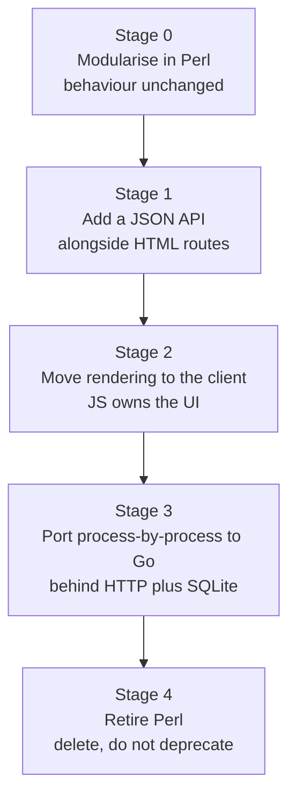

# Migration Roadmap

**Status:** draft — Stage 0 in progress
**Started:** 2026-10-23
**Related:** `docs/AGENTS-notes.md` (data model), `AGENTS.md` (run/restart, rules)

The goal of this document is to move JawnOS off Perl and onto a stack we can own, without
stopping the house for a single day. It is a *sequenced* plan, not a rewrite brief. Every stage
is shippable on its own and the system keeps running between them.

---

## 1. Charter

> Replace the implementation under JawnOS, one well-tested seam at a time, in an order that
> never leaves the house without a working manager.

Three intents, in priority order:

1. **Continuity.** The app runs throughout. No big-bang cutover, no two-week window where the
   panel is half-broken.
2. **Ownership.** Shrink what we must maintain to something a small team can hold in their
   heads, and eventually own outright (see `docs/migration-roadmap.md` §5 and the stack-ladder
   discussion it formalises).
3. **Clarity.** The current shape — 685 routes in one 44,878-line file, 727 global functions,
   no tests — is the real bug. Porting it faithfully would preserve the defect in a new language.

An explicit corollary: **this document optimises for #1 and #3, and treats #2 as the reward,
not the deadline.**

---

## 2. Decisions

| # | Decision | State | Note |
|---|---|---|---|
| D1 | Target server language is **Go** | *proposed* | Rationale in §5.4. Not ratified until Stage 2 exits. |
| D2 | Firmware stays C/C++ (LVGL, ESP-IDF, Pico SDK) | **accepted** | Out of scope entirely, beyond interface contracts. |
| D3 | SQLite remains the storage engine | **accepted** | Schema is the contract across every stage; do not replace it during migration. |
| D4 | Client rendering replaces server-rendered fragments | *proposed* | The enabler for D1. §5.3. |
| D5 | No new Perl dependencies during Stage 0 | **accepted** | Stage 0 is subtraction and relocation only. |
| D6 | Route definition order is preserved exactly | **accepted** | See §6.8 — Mojo matches in definition order. |

### Open questions

| # | Question | Needed by |
|---|---|---|
| Q1 | How is an isolated second manager instance started (own DB, own port, own log)? Needed for the golden-master harness. | Stage 0.1 |
| Q2 | Do we keep `Mojolicious::Lite`'s top-level DSL during Stage 0, or convert to `$app->routes` immediately? | Stage 0.4 |
| Q3 | Is the mesh wire format frozen while servers are mixed-version? (Old Perl workers and new Go workers must interoperate.) | Stage 3 entry |
| Q4 | What is the acceptance bar for "identical behaviour" — byte-identical HTML, or semantic equivalence? | Stage 0.1 |

---

## 3. Measured baseline

Taken from the tree on 2026-10-23. Re-measure before each stage; these are the numbers the
plan is sized against.

| Metric | Value | Why it matters |
|---|---|---|
| Perl (`*.pl`) | 91,707 lines / 44 files | Port surface |
| — `Manager.pl` | 44,878 lines, 556 subs | 49% of all Perl in one file |
| — `subroutines.pl` | 30,207 lines, 971 subs | Shared procedural core |
| Templates (`*.ep`) | 19,410 lines / 213 files | UI coupling |
| — lines containing Perl tags | 7,852 (40%) | Logic is interleaved with markup |
| Client JS | 81,565 lines / 79 files | The asset that makes D4 possible |
| Route definitions | **685**, in **184** path families | Real HTTP surface |
| `->render(` calls | 1,276 | Server renders fragments, not JSON |
| `->json(` calls | 0 | No HTTP API boundary exists |
| `encode_json` uses | 305 | JSON is emitted ad hoc, mostly for websocket frames and stored blobs |
| Distinct `subs::` functions called | 727 | Flat global namespace |
| `subs::` call sites | 9,703 | Every one is a port target |
| `eval { }` blocks | 2,047 | Used as try/catch; becomes native error handling |
| String `eval` | 9 | Negligible — good news |
| `ref $x` dispatch | 790 | Runtime type dispatch; needs modelling, not mechanical translation |
| File-scoped `my` / `our` in `Manager.pl` | 17 / 15 | **The extraction hazard** — see §6.3 |
| Route handlers as closures | 681 | All handlers can capture that file-scoped state |
| Inline HTML in `Manager.pl` | 25 blobs | Extract to templates first |
| Test files (`t/`) | **0** | There is no safety net. Build one before moving anything |
| Inter-process HTTP calls | 66 | Existing seams — the strangler-fig's friends |

### Route families, top ten

| Family | Routes | First line | Span |
|---|---|---|---|
| configure | 99 | 5,604 | 34,460 |
| security | 46 | 34,541 | 2,551 |
| mail | 41 | 28,547 | 14,026 |
| store | 27 | 4,559 | 24,753 |
| market | 27 | 2,734 | 1,457 |
| help | 26 | 31,662 | 2,801 |
| folders | 24 | 26,735 | 13,398 |
| embedded | 19 | 8,128 | 32,011 |
| people | 18 | 22,479 | 805 |
| budget | 14 | 20,196 | 1,397 |

Two facts drive the whole of Stage 0:

- **The top ten families hold 341 of 685 routes; the remaining 174 families share 344.** Half
  the surface is a long tail, so extraction has to be a *scripted recipe*, not bespoke surgery
  repeated 184 times.
- **Families are not contiguous.** `configure` spans lines 5,604–40,064; `store` spans
  4,559–29,312; `embedded` spans 8,128–40,139. The file is ordered by accretion, not by
  feature. You cannot extract a module by cutting a block — you must collect scattered routes
  and preserve their relative order.

---

## 4. Non-goals

- No schema redesign during migration. The schema changes *after* the port, deliberately.
- No framework rewrite of the client in Stage 0–1.
- No new features. Stage 0 is behaviour-preserving to the byte where possible.
- No firmware changes.
- No "fix it while we're in there." Every incidental cleanup is its own commit, before or
  after the move — never inside it.

---

## 5. Stage map



| Stage | Goal | Entry criterion | Exit criterion |
|---|---|---|---|
| 0 | One file becomes ~30 modules | Safety net green | `Manager.pl` under 3,000 lines, all modules load, snapshots unchanged |
| 1 | A real HTTP API exists | Stage 0 exit | Every mutation usable over JSON; HTML routes still work |
| 2 | Client renders; server serves data | Stage 1 exit | No new `->render(` in server code; UI features ship client-side |
| 3 | Go workers replace Perl workers | Stage 2 exit + Q3 answered | Each process ported behind the wire contract, both live simultaneously |
| 4 | Delete Perl | All processes ported | `*.pl` count is zero; nothing imports a Perl module |

### 5.1 Stage 0 — modularise in Perl

**Deliverable:** `Manager.pl` reduced from 44,878 lines to a registration manifest of route →
handler wiring, with handler bodies living in domain modules.

**Why this first:** it is work that must happen regardless of language. It shrinks the port
surface, makes the 32 shared lexicals explicit, and produces the per-family test coverage that
Stage 3 depends on. Even if D1 is never ratified, Stage 0 pays for itself.

### 5.2 Stage 1 — JSON API alongside HTML

**Deliverable:** a documented `/api/...` surface, authenticated the same way as the HTML
routes, with **zero** changes to existing behaviour.

**Method:** each route handler's logic is split into a *command* (returns a data structure)
and a *presentation* (renders it). Add the API route that calls the command; leave the HTML
route calling the command then rendering. Both must produce the same outcome.

**Gate:** for every mutating route, replay the same form parameters to both the HTML and the
JSON path against a snapshot DB and assert identical row-level results.

### 5.3 Stage 2 — rendering moves to the client

**Deliverable:** the 1,276 `->render(` call sites stop growing, then shrink.

**Method:** new screens are client-rendered against the Stage 1 API. Existing screens convert
only when they are being touched anyway. The target is not "rewrite the UI" — it is "the server
stops being a template engine."

**Why this is the real unlock:** with no HTTP API there is no seam, so a language port would
have to reproduce 7,852 lines of embedded Perl in templates. With an API, the server becomes a
thin command + storage layer — the part that ports mechanically.

### 5.4 Stage 3 — port to Go, process by process

**Deliverable:** `Manager`, `Websocket`, `Alarm`, `Music`, `watch`, `teletype`, `pen` each
either ported or retired, one at a time.

**Method:** the 66 inter-process HTTP calls are the seams. A Go worker joins the mesh, speaks
the same wire format, writes the same tables, and the Perl worker is switched off behind a
feature flag. Rollback is "turn the flag back."

**Why Go:** static single binary (Termux installs stop being an adventure), goroutines map onto
the `$ENV{PURPOSE}` worker model and the 5-minute sync loops, standard library covers HTTP +
websocket + TLS + JSON + crypto + SQL, and the runtime is small enough to be plausibly ownable
— which deletes two layers from the "own the whole stack" bill (no glibc, no perl interpreter).

**Non-fit noted:** Rust is the better tool for new crypto and serialization work, and the wrong
tool for this codebase's 790 runtime dispatches and hash-of-hash modelling.

### 5.5 Stage 4 — retire

Delete, do not deprecate. A "temporarily kept" Perl worker is how migrations stall.

---

## 6. Stage 0 — detailed draft

### 6.1 Safety net first (0.1)

`t/` is empty. Nothing may move until a golden-master harness exists. The harness must:

1. **Isolate.** Copy the live DB to a scratch directory (`sqlite3 ... "VACUUM INTO '<tmp>'"` for
   a WAL-safe snapshot) and run a manager instance against the copy on a throwaway port with
   its own log. *(Q1 — confirm how a second instance is started.)*
2. **Capture.** For every `GET` route: status, content-type, body SHA-256, and the body itself
   for diffing. For every `POST`: the recorded form payload, status, response SHA-256, plus a
   before/after hash of every touched row.
3. **Replay.** Fixtures only — the sanctioned test names from `AGENTS.md`. No real people, no
   real appointments. Never open a centre or appointment view to inspect it; capture the HTTP
   response instead.
4. **Report.** A stable machine-readable manifest (`t/golden/<family>.json`) that a later run
   diffs against.

Entry gate for any extraction: the harness covers that family's routes and is green twice in a
row (catching order- and state-dependence).

### 6.2 Dependency bill of materials (0.2)

`Makefile.PL` declares exactly one prerequisite (`Mojolicious`) while the code uses 91 distinct
modules. Before porting anything, produce the real inventory: resolve each `use` to its
distribution and version, walk the prerequisites transitively, and emit a pinned manifest.
This is both a migration input and a supply-chain fix that stands on its own.

### 6.3 Shared-state census (0.3)

**Do this before moving a single route.** `Manager.pl` has 17 file-scoped `my` and 15 `our`
declarations, and 681 route handlers are closures that can capture them. Any handler that
mutates captured state becomes a different program the moment it lives in another package.

For each of the 32, record: name, initialiser, every handler that reads it, every handler that
writes it, and whether it is per-request (should be route-local) or process-lifetime (should be
an explicit service object). The 32 divide into three buckets:

| Bucket | Action |
|---|---|
| Per-request scratch | Make it a local inside the handler; delete the file-scoped copy |
| Process-lifetime cache / handle | Move behind a named accessor owned by one module |
| Genuinely global configuration | Keep, but expose through one explicit context object |

A handler that both reads and writes shared state is not extractable until its bucket is
resolved. This list is the Stage 0 critical path.

### 6.4 Route manifest (0.4)

Generate a machine-readable inventory: `family`, `method`, `path`, `line`, `handler name`,
`captured lexicals`, `subs:: calls`, `templates rendered`, `tables touched`. Two products:

- **The extraction order** (§6.5), computed rather than guessed.
- **A coupling score** per family — how many *other* families' routes call into it. High
  inbound coupling means extract late.

This is the first executable deliverable and it should be a script in `scripts/`, not a
hand-maintained list, so it can be regenerated after every extraction.

*(Q2 decides whether routes are converted to `$app->routes->get(...)` now or later. If
converted now, ordering must be enforced by a single ordered registration loop.)*

### 6.5 Extraction order

Ordered by **blast radius, not size**. Leaf features with no inbound coupling go first; money,
security, and the device mesh go last.

| Wave | Families | Why here |
|---|---|---|
| 1 — Leaves | warehouse, measures, tasks, resolve, agents, marker, lorawan, teletype, unclaimed | Few routes, isolated, low coupling. Proves the recipe. |
| 2 — Small opaque | studio, gallery, terminal, editor, web, inventory, travel | Contain logic, rarely called from elsewhere |
| 3 — Feature modules | budget, relational, coding, ide, people, folders | Self-contained but referenced by others |
| 4 — Money | market, store, budget-adjacent transaction | Every change needs a row-level diff, not just HTML |
| 5 — Security & identity | security, crypto, box_office, device, notifications | Wrong behaviour here is silent and serious |
| 6 — Device mesh | embedded, watch, lorawan, phone, sms | Hardware in the loop; hardest to verify |
| 7 — Configure | configure | 99 routes, spans 34k lines, touches everything. Last by construction. |

Each wave must exit its gate before the next begins. A wave that cannot reach byte-identical
snapshots is a signal that the coupling census in §6.3 missed something.

### 6.6 Per-family recipe

Same steps every time. If a family needs a different recipe, stop and fix the recipe.

1. Regenerate the route manifest; confirm the family's routes are all accounted for.
2. Ensure golden coverage for every route in the family; run twice; both green.
3. Extract route bodies into named subs first — `post '/x' => \&domain_x;` — still in place.
   Run the golden set. **This step alone should never change behaviour.**
4. Move the named subs into the domain module, one route at a time, running the golden set
   after each. Diffs get a commit of their own.
5. Resolve captured lexicals per §6.3; replace with explicit parameters.
6. Move inline HTML (if any) into a template; diff the rendered body.
7. Re-run the full golden set, not just the family's.
8. Only then: delete the old code. No commented-out bodies.

### 6.7 Target layout

```
JawnOS/
  Manager.pl              # registration manifest only: ordered route wiring
  lib/JawnOS/
    Context.pm            # the explicit context object replacing shared lexicals
    Storage.pm            # db_query/db_select/db_update/db_insert/db_delete
    Settings.pm           # setting_grabber/setting_setter/settings_grabber
    Web/Routes/<Family>.pm # one module per route family, register($app)
    Domain/<Thing>.pm      # commands that return data, no HTML
    Present/<Thing>.pm     # render data -> response (shrinks as Stage 2 proceeds)
  subroutines.pl          # drains module by module, then deleted
```

Two rules for the layout:

- **`suds`-style per-request state never lives in a module variable.** Pass it.
- **`Storage` and `Settings` are extracted first among the shared code**, because they are
  called ~3,000 times between them and are already an interface. Porting them once means the
  rest of the port is presentation.

### 6.8 Invariants

Non-negotiable, checked in review:

1. **Route order is behaviour.** Mojolicious matches in definition order. Regrouping by family
   changes which route wins for overlapping paths and wildcards. Preserve the global order in
   the manifest, even if it reads oddly.
2. **The DB schema does not change** in Stage 0. Not one column.
3. **No behavioural diff in the golden set** is a hard failure, not a judgement call. If a diff
   is *correct*, fix the original first in its own commit, re-baseline, then move.
4. **One family per commit series.** Never two families in flight.
5. **No new dependencies.** If a move seems to need one, the move is wrong.
6. **No test skipped for being inconvenient.** A route that cannot be captured is a finding to
   document, not a route to ignore.

### 6.9 Definition of done for Stage 0

- [ ] Golden-master harness exists, is green, and runs on every family before and after.
- [ ] Dependency manifest is pinned and generated by script.
- [ ] All 32 shared lexicals resolved and documented.
- [ ] Route manifest is regenerated by script and current.
- [ ] `Manager.pl` is a registration manifest under 3,000 lines.
- [ ] `subroutines.pl` is empty or deleted; its 971 subs distributed or retired.
- [ ] `perl -c` passes on every module; app boots; a full route smoke passes on fixtures.
- [ ] Every extracted family has a help topic that still matches the UI it serves.

---

## 7. Risk register

| Risk | Likelihood | Impact | Mitigation |
|---|---|---|---|
| Route-order change silently alters dispatch | High | High | §6.8.1; manifest preserves order; snapshot every overlapping path |
| Captured lexicals leak semantics across modules | High | High | §6.3 census first; one family per commit |
| No tests means "green" is false confidence | High | High | Harness built before any move; run twice to catch state |
| Stage 1 API forks behaviour from HTML path | Medium | High | Shared command layer; both paths asserted per mutation |
| Mixed-version mesh during Stage 3 | Medium | High | Q3 answered first; wire format frozen; feature flag rollback |
| Stage 0 becomes a rewrite in disguise | Medium | High | §4 non-goals; §6.8.3 hard diff gate |
| Telnet/device routes impossible to snapshot | Medium | Medium | Document as a known-uncaptured set; verify on hardware manually |
| Termux/permissions differ from desktop | Low | Medium | Every wave smoke-tested on the phone before merge |
| `configure` never finishes | Medium | Medium | It is last by design; a 99-route family that stays in `Manager.pl` is an acceptable end state for Stage 0 |

---

## 8. Gates and metrics

Tracked per wave, not per feeling:

| Metric | Stage 0 start | Stage 0 exit |
|---|---|---|
| Largest file (lines) | 44,878 | < 3,000 |
| Routes in `Manager.pl` | 685 | 0 (manifest only) |
| Distinct `subs::` globals | 727 | < 100 |
| Golden routes covered | 0 | ≥ 80% of GET+POST, all of waves 1–4 |
| `->render(` in server code | 1,276 | ≤ 1,276 (Stage 1 begins the descent) |

---

## 9. Next actions

1. Answer **Q1** (isolated instance) — it gates the harness.
2. Build the golden-master harness on the smallest family (`measures`, 4 routes).
3. Write the dependency bill-of-materials script.
4. Write the route-manifest script (the first scripted artifact in the plan).
5. Run the shared-state census and publish the 32-row table.
6. Begin Wave 1.

---

## Appendix A — What this document deliberately does not decide

- The wire format for Stage 1 (JSON shape, versioning, error envelope).
- Whether Go replaces *all* processes or only the manager, with the rest written in whatever
  fits best (the mesh is small enough that mixed-language is viable).
- How the client is structured after Stage 2 (the 81.5k lines of existing JS are an asset, but
  they were written against fragment endpoints).
- Anything about owning the OS below — kernel, libc, toolchain. That is a separate, longer
  programme, and Stage 0–4 change its size materially by removing the Perl runtime from the
  bill.
