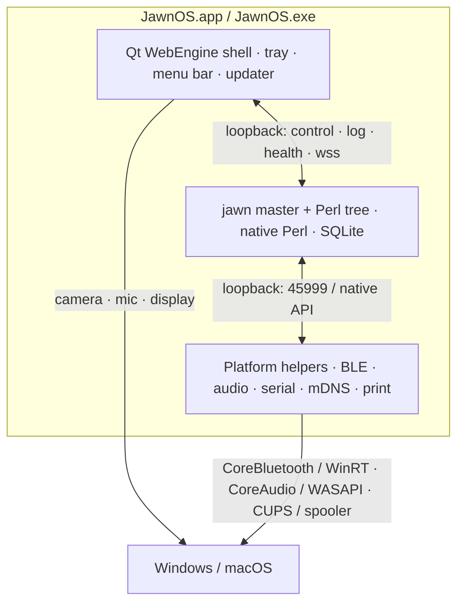

# Native Windows and macOS Roadmap

**Status:** P0 in flight (2026-11-09). Slices 1–2 landed: the questions are answered, the
capability probe exists, portable mode has a Daemon server and a pipe runner, and control/log/watch
speak loopback TCP with a token when asked. Slice 3 has begun: process identity, state and the
process-group scan live in `lib/JawnOS/Platform/Process.pm` (Linux backend). Slice 4 landed the
worker tail: no source imports `IO::Socket::UNIX` at compile time, and the alarm, memory, ws and
mailws surfaces ride the same TCP transport (with the token) in portable mode. No Mac or Windows
hardware is present yet, so the hardware exits wait for it. Runbook and acceptance checklist:
`docs/platform-p0.md`.
**Related:** `desktop/README.md` (the Qt shell and today's supervisor), `docs/docker.md` (the
headless server), `docs/migration-roadmap.md` (the Go path, the alternative endgame),
`docs/infrastructure-roadmap.md` (where containers still belong).

## 1. Charter

Ship JawnOS as a **native, installable program** on Windows and macOS: the same house, the same
`device=computer` capabilities as the Linux desktop, the Perl tree running on the **same loopback
and the same filesystem** as the Qt shell, with no Docker, no WSL, and no external Perl/Python
requirement.

Three intents, in priority order:

1. **A full house machine.** These are not thin clients. BLE, watch/teletype, audio and music, TTS,
   reception, serial/firmware, printing, LAN discovery, Tailscale and the file manager must work the
   way they work on Linux today.
2. **Local by construction.** The supervisor, server and platform helpers all run on one machine.
   Every deliberate `127.0.0.1`, UNIX socket and loopback health check stays true. This is why the
   container is not the desktop artifact.
3. **A normal install.** Double-click, first run, tray/menu bar, autostart, auto-update, uninstall.
   No terminal, no `docker compose`, no `perl`, no `python` for the person using it.

Qt already supplies the UI engine on all three platforms. The work here is the server's
**process/socket/platform layer** and the **host hardware lane** — not another UI port.

## 2. Decisions

Accepted 2026-11-08, unless marked otherwise.

| # | Decision | State | Note |
|---|---|---|---|
| D1 | Windows and macOS are **full house machines** (`device=computer`) | **accepted** | Feature parity with the Linux desktop, not a remote client. |
| D2 | The server is **local** to the shell, on the same loopback | **accepted** | No remote server and no container/VM boundary in the desktop build. |
| D3 | macOS is **native**: a notarized `.app` with a bundled relocatable Perl 5.40 | **accepted** | POSIX means `fork`, threads, signals, PTY and UNIX sockets keep working. |
| D4 | Windows is **pure native**: a signed MSI/MSIX with a bundled Perl runtime | **accepted** | No WSL and no Docker dependency. This is the largest risk; see §6.1 and §10. |
| D5 | Ports are a **bounded range**: fixed base plus offsets, plus a configured tunnel range | **accepted** | Replaces the random `50000–65000` tunnel pool. |
| D6 | Docker remains the **headless server** deployment only | **accepted** | `docs/docker.md`; not the desktop. |
| D7 | Qt WebEngine stays the only UI engine | **accepted** | Already true; no GTK/WebKitGTK fallback. |
| D8 | Keep Perl for this roadmap | **accepted for now** | The Go migration is the alternative if the Windows process model proves too expensive. |
| D9 | Direct distribution first, not the App Store or Microsoft Store | **proposed** | macOS sandbox would block child processes and broad file access. |

## 3. Resolved questions (2026-11-08)

The original Q1–Q10 are answered here. The reasoning and the runbook are in
`docs/platform-p0.md`; the answers that need a real machine are proposals for the
P2/P3 exits, not measurements.

| # | Question | Answer |
|---|---|---|
| Q1 | Windows Perl runtime | **Bundle Perl 5.40.** Portable Strawberry Perl for the P0 spike; a relocatable threaded build for release. The tree needs roughly a dozen XS modules (`DBD::SQLite`, `Net::SSLeay`, `Sereal`, `CryptX`, `Clone`, `HTML::Strip`, `Data::UUID`, `Compress::Zlib`), pinned as in `Dockerfile:35-68`. `use threads` only opened a browser and is now gone; it does not make Strawberry's emulated `fork` safe, so Windows stays no-fork. |
| Q2 | Prefork on a desktop | **No prefork; one `Mojo::Server::Daemon` per purpose.** Target 3 concurrent request slots (today's desktop resting count). One Daemon grows in concurrent connections, not in blocking parallel work; if the measured blocking surface is too large, the portable fallback is N Daemons behind a small loopback dispatcher (P3), or the work moves to Minion. |
| Q3 | subprocessor fork model | **Split, do not convert.** Resident loops and servers become supervised processes; durable one-shots become Minion jobs; request-scoped work stays a fork. Windows runs one Daemon per server, one consolidated loops process, one Minion worker, and the BLE helper. |
| Q4 | ConPTY or pipe | **Plain pipe.** The master never writes to the tree; a pipe only needs the tree's stdout autoflushed. No PTY use exists outside the master runner. |
| Q5 | Control/log/watch transport | **Loopback TCP plus a per-boot token on Windows; AF_UNIX on macOS/Linux.** Protocols stay one JSON line (control/log) and length-prefixed Sereal (watch); only the socket constructor and token check change. Implemented in `lib/JawnOS/Transport.pm` (slice 2), and extended to the worker surfaces (alarm, memory, ws, mailws) in slice 4. |
| Q6 | Always-on | **Tray/menu bar plus a login item, not a service.** The desktop house needs the user session for audio, camera and the GUI; the headless server keeps systemd/Docker. When no user is logged in, the desktop house is down. |
| Q7 | macOS data directory | **Tree copy in `~/Library/Application Support/JawnOS`; runtime state in `~/.president`.** Add `JAWNOS_DIR` and `JAWNOS_DATA_DIR`; updates replace the tree copy and never the data. |
| Q8 | Reception and hardware wallet | **Later, both.** Reception is a BlueZ/SCO/PipeWire project with a native helper; the wallet is opt-in vendor drivers. Ship "not on this platform" stubs, not implementations. |
| Q9 | Minimum OS/CPU | **Propose Windows 10 21H2+/11 x64 and macOS 13+ arm64/x64.** Verify the PySide6 wheel minima in CI. No Windows ARM64 in v1. A pipe removes ConPTY's 1809 floor as a constraint. |
| Q10 | Hardware test plan | **One Apple Silicon Mac, one Windows 11 x64 mini-PC, a Pico 2 W, a watch, a deck, a USB BT dongle, an IPP printer and a USB serial board.** CI probes; the hardware acceptance run is recorded per version. |

## 4. What Qt already solved

- One engine for the Manager, the native Browse window and the session bar:
  `desktop/jawnos_desktop/qt_shell.py`, `browser.py`, `shell.py`.
- The toolkit-neutral page bridge in `desktop/jawnos_desktop/bridge.py`; the Qt shell installs the
  legacy `window.webkit.messageHandlers` shim (`qt_shell.py:360-385`), so app signing, peer Manager
  windows, Browse and media keep-awake are already portable.
- The Linux-only paths degrade cleanly: `prepare_wayland_env()` returns without
  `WAYLAND_DISPLAY` (`qt_shell.py:182-199`), and the permission code handles Qt 6.8 and older
  spellings (`qt_shell.py:750-760`).
- `--probe` and `t/185-desktop-qt-shell.t` are the per-machine regression check; they skip when
  PySide6 is absent.

The seed of this plan was the old Windows note in `desktop/README.md` (`core_win` plus a WinRT BLE
backend). It is not enough: macOS, the server process model, paths, secrets, ports and the hardware
lane all need a home.

## 5. Target shape

The shell stays the supervisor it already is (`desktop/jawnos_desktop/core.py`): it starts the
server, watches it, reads the log, opens the ticket URL and keeps the tray badge. The difference is
that the platform layer supplies spawn/kill/paths/secrets instead of Linux `/proc`, `ip`, `kill`
and XDG paths.

## 6. The portability surfaces

### 6.1 Process and supervision — the Windows blocker

This is the part that decides whether native Windows is a packaging job or a rewrite.

Current Linux/POSIX dependencies:

- `President.pl` does `use threads` and `fork` (`President.pl:35-39`); the prefork pool is
  `Mojo::Server::Prefork` (`President.pl:690-700`).
- `fork` is used for subprocessors, tunnels, coding, upgrades and the parent guard
  (`President.pl:609-620`, `parent_guard.pl:22-58`).
- The master runs the tree through a **PTY** (`jawn:1530-1613`,
  `Mojo::IOLoop::ReadWriteFork` with `type => 'pty'`).
- `~/.president/control`, `~/.president/log` and the watch socket are UNIX sockets
  (`jawn:1315-1527`, `perl/control.pl:26-40`).
- Process identity and state come from `/proc` through `lib/JawnOS/Platform/Process.pm`
  (`parent_guard.pl`, `Domain/Process.pm`, `Ble/Guard.pm`); `jawn:866-900`, `manager_misc.pm:472-546`,
  `crew.pl:151-161` and `scripts/manager_killer.pl:65-100` still read it directly.
- `kill`, `waitpid` and signals are assumed throughout; `parent_guard` already has a
  `PR_SET_PDEATHSIG` fast path guarded by `$^O eq 'linux'` with a heartbeat fallback
  (`parent_guard.pl:142-146`).

Strawberry Perl emulates `fork`, and that emulation does not mix safely with `use threads` — which
is exactly the combination at the top of the tree. `Mojo::Server::Prefork` requires `fork`.

Candidate design (confirmed or rejected by the P0 spike):

- A platform flag (`can_fork`, `can_pty`, `can_unix_socket`) and a **no-fork mode**.
- On Windows, run one `Mojo::Server::Daemon` process per server instead of Prefork. A desktop house
  does not need prefork's throughput; the websocket worker and the main worker can be separate
  processes started with `Win32::Process`, or the same process if the load allows.
- Background work (`subprocessor`, upgrades, coding, tunnel holders) becomes Minion jobs or a small
  managed worker process, not `fork`.
- The parent guard becomes a Job Object with `JOB_OBJECT_LIMIT_KILL_ON_JOB_CLOSE`, or a watchdog
  process, instead of `PR_SET_PDEATHSIG`.
- The master's PTY becomes ConPTY (Windows 10 1809+) or a plain pipe; the tree's output is
  line-oriented, so a pipe may be enough.
- Control/log/watch move to loopback TCP plus a token on Windows; UNIX sockets stay on
  macOS/Linux. The protocol is already one JSON line in, one JSON line out
  (`perl/control.pl:223-233`), so the transport is the only change.
- Process listing uses `Win32::Process::Info`/`Proc::ProcessTable`/`tasklist` on Windows and
  `ps`/`sysctl` on macOS, behind one interface.

**P0 must prove this on Linux before a Windows box exists**: implement the no-fork, no-PTY,
TCP-control "portable mode" on Linux and run a smoke house plus the suite. If the tree cannot boot
and serve without `fork`/PTY/UNIX sockets, native Windows is a rewrite, and the Go path in
`docs/migration-roadmap.md` is the honest alternative.

### 6.2 Filesystem and paths

- The tree is cwd-relative: `require './perl/...'`, `./database`, `./config.json`, `./server`,
  `voices/`, `releases/`. An app bundle is not a writable working directory.
- Copy the tree into the platform data directory on first run, the way `desktop/install.sh` copies
  to `~/.local/share/jawnos/desktop`, and run from there. Mutable state lives beside the copy; code
  updates replace the copy.
- Platform paths: `%LOCALAPPDATA%\JawnOS` and `%APPDATA%\JawnOS` on Windows;
  `~/Library/Application Support/JawnOS` on macOS. Add explicit env overrides (`JAWNOS_DIR`,
  `JAWNOS_DATA_DIR`) instead of relying on `$HOME`.
- Name rules: Windows reserved names (`CON`, `NUL`, `COM1`, …), the characters `<>:"/\|?*`, long
  paths, and case-insensitive NTFS/APFS. `subs::path_name`, `html_name` and `http_name` are the
  existing sanitizers; add a platform-specific component check.
- `JAWNOS_FOLDERS` uses `:` as a separator; on Windows a host path such as `C:\Music` contains a
  colon. Keep the list to container/data-dir paths, or move it to a JSON list.
- Line endings, executable bits, symlinks and `chmod 0600` all differ. The ticket store
  (`desktop/jawnos_desktop/secrets.py:7-10`) needs Keychain on macOS and Credential Manager/DPAPI on
  Windows; the Fernet file remains the fallback.

### 6.3 Network and discovery

- Interface parsing: `ifconfig`, `ip route`, `netstat -avnpt` and `arp` in `Device.pm:86-105`,
  `Edt.pm:526-566`, `Network.pm:416-426` and `manager_configure2.pm:96-108`. macOS has different
  interface names and no `ip`; Windows has `ipconfig`/`Get-Net*` and `netstat -ano`.
- mDNS: `avahi-browse`/`avahi-publish-service` (`Edt.pm:712-722`, `Network.pm:416-426`) becomes
  `dns-sd` on macOS and the DNS-SD/WinRT API on Windows.
- Tailscale: the macOS app/CLI and the Windows service replace the Linux `tailscale` binary; the
  interface filters need `utun` and `Tailscale`. The in-app VPN controls
  (`Warehouse.pm:756+`, `scripts/jawnos_network.pl`) must call the platform CLI.
- LAN scanning and presence run on the host, so they see the real LAN. There is no port publish and
  no NAT.
- The Network app's `iwctl`/`ip`/`tailscale`/`systemctl` helper (`Core1_tables_hooks.pm:759-763`)
  needs a platform backend; the Android app already proves the `device_call`-style bridge pattern.

### 6.4 Hardware lane

- **BLE**: `ble.py` is BlueZ/D-Bus (`ble.py:64-68`) and binds `127.0.0.1:45999`
  (`ble.py:1485-1495`). Port it to CoreBluetooth (macOS) and WinRT (Windows) behind the same JSON
  protocol and port. The server and the bridge are on the same loopback, so no host-agent boundary
  is needed.
- **Audio, TTS, music**: `pactl`/`pacat` (`perl/Music/01_remote_audio_receiver.pl:177-187`,
  `02_remote_audio_stream.pl:70-80`) and `wpctl`/`amixer` (`Pay2.pm:614-626`) become CoreAudio on
  macOS and WASAPI on Windows. Bundle Piper/espeak/sox; macOS `say` remains a fallback. Decide
  whether real-time remote audio is in the first release or later parity.
- **Reception**: `lib/JawnOS/Sco/`, `perl/sco/sco_helper.c` and PipeWire are Linux-specific. A
  native macOS (IOBluetooth/CoreAudio) and Windows (Bluetooth/WASAPI) implementation is a separate
  project; mark it `later` unless it is required for the first release.
- **Serial/firmware**: `/dev/ttyACM*` and `/dev/ttyUSB*` (`Part34.pm:382-437`,
  `manager_embedded.pm:343-353`) become `/dev/cu.usbmodem*` and `COM*`. Bundle PlatformIO; OTA is
  unchanged.
- **Printing**: CUPS works on macOS; Windows needs a spooler backend instead of
  `lpstat`/`lp`/`lpadmin` (`Printer2.pm:58-68`).
- **Clipboard, notifications and open-with**: `xclip`, `notify-send` and `xdg-open` become `pbcopy`
  / `osascript` / `open` on macOS and the Win32 clipboard / toast / `ShellExecute` on Windows.
- **Camera, microphone, screen capture**: Qt WebEngine grants these to the house origins
  (`qt_shell.py:717-732`); the OS privacy settings and entitlements are part of packaging.
- **Hardware wallet**: vendor drivers on each platform; opt-in as on Linux.

### 6.5 Ports and loopback

The app's deliberate loopback assumptions are an asset on a native install and a liability in a
container. Keep them:

- Fixed base: `working_port` (45545 default), `+1` wss, `+2` watch/arm, `+3` bestow, `+4` coms,
  `+5` alarm, `+6` peer, plus `+101` plain WS on loopback (`President.pl:174-202`). The private
  worker transport adds `+7` control, `+8` log, `+9` watch, `+10` alarm, `+11` memory, `+12` ws and
  `+13` mailws; one ws port carries every app because the payload names it.
- The tunnel hub currently reserves **random ports in 50000–65000**, seven per peer
  (`manager_configure2.pm:666-699`, `gb.pl:31`). Replace that with a configured range
  (`tunnel_port_min`/`tunnel_port_max`, e.g. 50000–50127 for 18 peers) and a clear exhaustion error.
  The hub listeners bind `127.0.0.1` (`perl/tunnel.pl:151-163`), which is correct on a native
  install.
- The plain WS shortcut in `ws_url_for` (`Part35.pm:532-540`) keeps working because the page and the
  server are on the same loopback. No certificate or publish workaround is needed.
- Add installer firewall rules for the fixed range and the tunnel range on private networks; macOS
  prompts per signed binary, so sign early and keep a stable bundle id.
- Keep IPv4 for the first release; IPv6 is a later decision.

## 7. Capability matrix

`Must` = first native release; `Should` = next; `Later` = parity after the core works.

| Capability | Linux today | macOS target | Windows target | Priority |
|---|---|---|---|---|
| Qt app shell, tray/menu bar, autostart | yes | native `.app` | native MSI/MSIX | Must |
| Web UI, app-key bridge, peer windows, Browse | yes | Qt | Qt | Must |
| BLE bridge (watches/boards) | BlueZ | CoreBluetooth | WinRT | Must |
| Watch/teletype HTTP+WS | yes | direct | direct | Must |
| Chat / WebRTC / mic / camera / screen | Qt | Qt + OS permissions | Qt + OS permissions | Must |
| Music remote audio | PipeWire | CoreAudio | WASAPI | Must |
| TTS / voice | Piper/espeak/sox | CoreAudio + `say` | WASAPI | Must |
| LAN discovery, presence, mDNS | ifconfig/avahi | native DNS-SD | native DNS-SD | Must |
| Tailscale / tailnet controls | CLI | app/CLI | service/CLI | Must |
| Notifications, clipboard, open-with | xclip/notify-send | native | native | Must |
| File manager / Folders | yes | native paths | native paths | Must |
| Backup / restore | yes | port | port | Must |
| Auto-update | Linux shell | Sparkle or custom | MSIX/custom | Must |
| First-run + unlock code in the app | Linux shell | new | new | Must |
| Serial / USB firmware | `/dev/tty*` | `/dev/cu.*` | `COM*` | Must |
| Printing | CUPS | CUPS | spooler | Should |
| Scanners / ZBar | bundled | bundled | bundled | Should |
| Reception (screened calls) | BlueZ/SCO/PipeWire | native rewrite | native rewrite | Later |
| Hardware wallet | opt-in | vendor | vendor | Later |

## 8. Phases

### P0 — decisions and spikes (no product code)

- Answer Q1–Q10, especially Q1 (Perl runtime), Q2 (prefork), Q3 (fork/threads) and Q5 (sockets).
- Implement **portable mode on Linux**: a capability flag turns off `fork`, Prefork, PTY and UNIX
  sockets; control/log/watch move to loopback TCP. Run a smoke house and the suite in that mode.
- Put `/proc` and network parsing behind a module and test the macOS implementation against recorded
  fixtures on Linux.
- Stand up CI compile jobs for Strawberry Perl and macOS Perl; add a `scripts/platform_probe.pl`
  that reports fork/PTY/socket/BLE/audio/serial capabilities.
- Write the hardware acceptance checklist and choose the machines (or the rental).

**Progress (2026-11-08, slice 1):**

- [x] Q1–Q10 answered (above)
- [x] `lib/JawnOS/Platform.pm` — the capability/mode flags, no server required
- [x] `scripts/platform_probe.pl` — what a box can do, human and JSON, `--check` for CI
- [x] Portable servers: `Mojo::Server::Daemon` instead of Prefork, a pipe instead of a PTY, and `use threads` removed
- [x] `lib/JawnOS/Transport.pm`: control/log/watch over loopback TCP with a per-boot token, while native keeps AF_UNIX
- [x] Runbook and hardware acceptance checklist: `docs/platform-p0.md`
- [x] CI probe jobs for Linux, Windows and macOS (Windows/macOS report-only until hardware)
- [x] Process identity, state, CPU ticks and the process-group scan behind `lib/JawnOS/Platform/Process.pm` (Linux backend; macOS/Windows to follow)
- [x] The websocket worker, mailws, alarm and memory sockets off `IO::Socket::UNIX` at compile time (the worker tail rides TCP in portable mode)
- [ ] Network parsing behind `JawnOS::Platform::Net` and `::Mdns`
- [ ] Portable smoke house and suite green on a spare checkout

The portable path is behind `JAWNOS_PORTABLE`; native Linux/macOS behaviour is
unchanged, so this is a spike, not a migration.

**Exit:** a written go/no-go on the Windows process model, and a Linux house running in portable
mode with the suite green. If the spike fails, stop and take the Go path.

### P1 — platform abstraction

- Add `JawnOS::Platform::Process`, `Net`, `Mdns`, `Audio`, `Serial`, `Print`, `Shell`, `Paths` and
  `Ports`; Linux implementations preserve today's behavior exactly.
- `desktop/jawnos_desktop/core.py` gets the same split for spawn/kill/paths/secrets/autostart.
- Every new domain sub goes in `lib/JawnOS/Domain/Loader.pm` (`t/91`), every new Manager helper in
  `lib/JawnOS/Manager/Index.pm` + `Declarations.pm` (`t/54`), and every new test gets a
  `# tests-for:` header (`t/99`).
- The tunnel range config lands here, because all three platforms need it.

**Exit:** Linux suite green, no behavior change, and the platform interface is small enough to port.

### P2 — macOS native

- Implement the platform modules: `ps`/`sysctl` for processes, `ifconfig`/`route`/`netstat` for the
  network, `dns-sd` for mDNS, `/dev/cu.*` for serial, CUPS for printing, CoreAudio for audio and
  volume, CoreBluetooth for BLE, `pbcopy`/`open`/`osascript` for the small surfaces.
- Package a notarized `.app` with a relocatable Perl 5.40 and the pinned modules; copy the tree to
  `~/Library/Application Support/JawnOS`; menu bar, LaunchAgent, Sparkle-style updates.
- Entitlements: Bluetooth, local network, microphone, camera, user-selected files; hardened runtime;
  sign every dylib.
- Acceptance: a `device=computer` house on a real Mac, `t/185`, the web UI, BLE, audio, serial,
  printing and LAN discovery.

**Exit:** the macOS app passes the capability matrix's `Must` rows on real hardware.

### P3 — Windows native

- Implement the no-fork mode: one `Mojo::Server::Daemon` per server, Minion/managed workers for
  background jobs, a Job Object or watchdog for the parent guard, ConPTY or a pipe for the tree
  output, and loopback TCP control/log/watch plus the token.
- Windows platform modules: `Win32::Process`/`Proc::ProcessTable`/`tasklist`, `ipconfig`/`Get-Net*`
  / `netstat -ano`, DNS-SD, WASAPI, `COM*`, the spooler, WinRT BLE, clipboard/toasts/`ShellExecute`.
- Package a signed MSI/MSIX with the bundled Perl runtime, Start menu, tray, "Start with Windows",
  firewall rules for the fixed and tunnel ranges, and an updater.
- Acceptance: a `device=computer` house on a real Windows box with no WSL, Docker, Perl or Python
  installed by the user.

**Exit:** the Windows app passes the same `Must` rows on real hardware.

### P4 — parity and hardening

- Reception, hardware wallet, tailnet controls, sleep/wake, crash recovery, backup/restore,
  migrations, performance/memory, and a security review of every loopback/TCP control surface.
- Auto-update, signing renewal, clean uninstall, and data-directory migration.

### P5 — release and QA

- A three-platform CI matrix (Linux, macOS, Windows), installer tests, offscreen Qt tests, and the
  hardware acceptance run recorded against a version.
- Help topics and the first-run wizard: the unlock code, ports, BLE, audio and the family of
  platform permissions belong in the app, not in a terminal or a container log.
- A support matrix (OS versions, CPU architectures, known hardware limits).

## 9. Test and hardware strategy (no boxes today)

- **CI first.** Use macOS and Windows runners for `perl -c`, the platform unit tests and
  `QT_QPA_PLATFORM=offscreen`. The UI acceptance still needs a real Qt WebEngine desktop view; a
  headless browser does not prove it (`docs/AGENTS-web.md`).
- **Portable mode on Linux** is the Windows proxy: run the suite with `fork`, PTY and UNIX sockets
  disabled. This catches POSIX assumptions before a Windows machine exists.
- **Hardware lane.** The acceptance rig: an Apple Silicon Mac, a Windows 11 x64 mini PC, a BLE 5
  adapter with a NUS watch/board, a USB serial board, a printer and an audio device. Borrow or rent
  until the project owns one of each.
- **Probe.** `scripts/platform_probe.pl` (and the shell's `--probe`) reports what the machine can do;
  a support ticket starts with its output.
- **No server from a worktree**, no binding tests in parallel with another agent: the usual
  concurrency rules (`docs/AGENTS-concurrency.md`).

## 10. Risks

| Risk | Likelihood | Impact | Mitigation |
|---|---|---|---|
| Windows `fork`/`threads`/Prefork/PTY cannot be removed without a rewrite | High | High | P0 portable-mode spike; if it fails, stop and take `docs/migration-roadmap.md` (Go). |
| XS modules (CryptX, Sereal, DBD::SQLite) do not build reproducibly on Windows | Medium | High | Q1; pin versions; build in CI; ship a prebuilt runtime. |
| PTY semantics: the master relies on terminal buffering or TTY detection | Medium | Medium | ConPTY first, pipe fallback; test the master's output parsing. |
| mDNS/firewall/LAN discovery differs or is blocked | Medium | High | Native DNS-SD, installer firewall rules, acceptance on a real LAN. |
| macOS notarization, entitlements or App Nap | Medium | Medium | Sign early, test on a clean Mac, prevent background suspension. |
| Audio/reception parity is much more than a backend swap | High | Medium | `Must`/`Should`/`Later` matrix; defer reception. |
| Three platform implementations drift | Medium | High | Thin interface, shared fixtures, one probe; no copy-pasted probes. |
| Scope creep from "full house" | High | Medium | The capability matrix is the contract; `Later` is allowed. |
| Signing/auto-update/installer friction | Medium | Medium | Choose Sparkle/MSIX early; test upgrade and uninstall. |
| The Go migration makes this work obsolete | Medium | Medium | Keep the platform seam thin; the Go path can reuse the interfaces. |

## 11. Definition of done

- A person installs a signed app on a clean macOS and a clean Windows machine, double-clicks it,
  completes first run, and the house is up as `device=computer`.
- Every `Must` row in §7 passes on real hardware; `Should` and `Later` are recorded, not silently
  missing.
- No Docker, WSL, Perl, Python or terminal is required by the user.
- Linux behavior is unchanged, and the suite is green on all three platforms.
- Backup/restore, auto-update and uninstall work; the database stays per device.

## 12. Not in this roadmap

- **Docker or WSL as the desktop runtime.** Docker stays the headless server (`docs/docker.md`);
  WSL is explicitly rejected for the desktop.
- **The Go rewrite.** It remains the alternative if P0 fails, and the strategic endgame in
  `docs/migration-roadmap.md`.
- **App Store or Microsoft Store distribution.** Direct, signed distribution first; sandboxing is a
  later decision.
- **Mobile and firmware changes.**
- **A hosted or cloud service.** The house is local.

## Appendix A — platform modules and the files they replace

| Module | Replaces |
|---|---|
| `JawnOS::Platform::Process` | `/proc` in `jawn`, `parent_guard.pl`, `manager_killer.pl`, `Ble/Guard.pm`, `manager_misc.pm`, `crew.pl`; `kill`/`waitpid`/signals; the parent guard; process spawn in `desktop/jawnos_desktop/core.py` |
| `JawnOS::Platform::Net` | `ifconfig`/`ip route`/`netstat`/`arp` parsing in `Device.pm`, `Edt.pm`, `Network.pm`, `manager_configure2.pm` |
| `JawnOS::Platform::Mdns` | `avahi-browse`/`avahi-publish-service` in `Edt.pm` and `Network.pm` |
| `JawnOS::Platform::Audio` | `pactl`/`pacat`/`wpctl`/`amixer` in `perl/Music/*`, `Pay2.pm`, `Say.pm` |
| `JawnOS::Platform::Serial` | `/dev/ttyACM*`/`ttyUSB*` in `Part34.pm`, `manager_embedded.pm` |
| `JawnOS::Platform::Print` | CUPS commands in `Printer2.pm` |
| `JawnOS::Platform::Shell` | `xclip`, `notify-send`, `xdg-open`, terminal lists and XDG autostart in `core.py` |
| `JawnOS::Platform::Paths` | XDG paths and `$HOME` assumptions in `core.py`, `secrets.py`, `jawn` |
| `JawnOS::Platform::Ports` | `working_port`/offset validation and the tunnel range |

## Appendix B — Windows process-model checklist

Before P3 is declared feasible, the P0 spike must answer:

1. Does the tree boot and serve `/manager/health` with `fork` disabled?
2. Does `Mojo::Server::Daemon` replace Prefork (main, websocket, alarm, teletype) acceptably?
3. Do background jobs (upgrades, coding, tunnels, sync) run through Minion or a managed worker?
4. Does the master's output work without a PTY, or does ConPTY work on the minimum Windows version?
5. Do control/log/watch work over loopback TCP with the existing token and the same JSON lines?
6. Does the parent guard survive a killed master (Job Object or watchdog)?
7. Does `manager_killer` find the right processes through `Win32::Process::Info`/`tasklist`?
8. Do the XS modules build and load under the chosen Strawberry Perl?
9. Do the fixed and tunnel port ranges pass Windows Firewall on a private network?
10. Does the Qt shell's `--probe`, the app-key bridge and the plain loopback WS path all pass?
