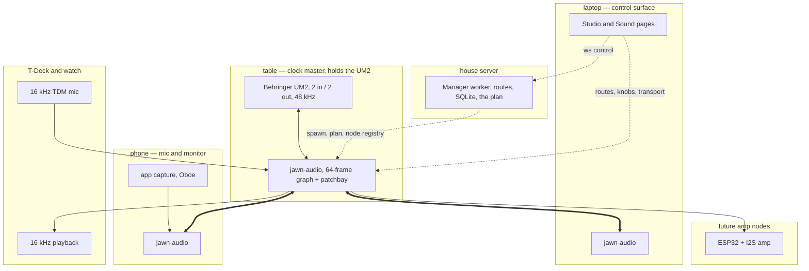

# Studio audio engine — a native engine and the house patchbay

> **Entry point:** `docs/roadmap.md`. This plan is **under way**: P0's device half is measured and
> P1's skeleton is built, while the network phases are not started. It is not on this season's
> critical path.

**Status:** measured and scaffolded, 2026-11-17. P0's device half is answered on `table` (§2): raw
ALSA holds 64 frames for three minutes; PipeWire does not hold quantum 64. The P1 skeleton is in the
tree (`engine/`, `scripts/build_engine.pl`, `t/332`) with the datagram header, the lock-free parameter
path, the block graph, a null device, master election and clock alignment. The
routing plan's shape and validation are `lib/JawnOS/Audio/Plan.pm` (`t/334`), and Studio reports the
browser's own numbers through `window.studioAudioReport()` (`t/333`).
**Still missing:** the laptop's browser numbers, and every network phase.

**The patchbay, 2026-11-18.** The saved plan now runs. `engine/src/patchbay.rs`
compiles `sources`, `buses`, `sinks` and `routes` into a stereo graph and runs it
on the device, with `--patch --plan FILE` on the command line and
`{"cmd":"patch","plan":{...}}` on the control socket. A node this machine
cannot bind (a peer, a phone, a zone, or another machine's node) is reported in
`silent` and contributes nothing; a route delay, an unknown endpoint, an
out-of-range gain or pan and a bus loop are refused before the device opens. The
plan is stored once for the house (`Domain::Audio`, a setting on the `all` device
row), read and saved from Sound's House patchbay, and applied only while its
master switch is on. The matrix shows each sink's declared latency and the
engine's state, frames, xruns and silent nodes. A fader moves the running patch
without re-arming it (`param` target `patch`); a node may name the machine it
live on, so one central plan can describe several machines. The manager writes
the startup copy and the supervisor passes it to a fresh engine, so
a reboot comes back routed. (2026-11-20: that copy is no longer under
`~/.president` — it sits in `~/.local/state/jawnos/audio/`, which the boot wipe
does not reach; see P1 and P5.) A machine with more than one interface picks the one
the engine opens in the same section (**Engine device**), stored beside the plan
in the startup file so the next spawn opens it. President starts the supervisor
when the engine binary is staged, so the switch needs no terminal work. What is
still network work: another machine's engine is not driven yet (P3), so the switch applies to
the engine on the server.

**Where a guitar stands, 2026-11-17.** Everything below the browser works: capture at 2.7 ms on
`table`, one to N tracks, the inserts, playback through the strips, overdub with a measured start
offset, a control socket and a supervisor. What is still missing for *hearing* an input is the
**live monitoring path** — input → its strip → the interface's outputs — and a machine with the
engine built and running. On `table` the WirePlumber rule hands the card to the engine, so the
browser cannot see it at all; until the engine monitors, a guitar plugged into the interface is
silent by design, not by fault. The instrument input is **channel 1** (the mic is 0), and the
patch cable used for the latency measurements still occupies it unless it has been unplugged.

**The panel layout, as it was meant.** The four panels should *pack*: a panel claims the span it
needs and the others reflow around it (CSS grid auto-flow with spans, or a masonry of columns),
rather than a fixed 2×2 where the transport always owns a quarter of the desk. The dock/float and
persistence underneath already support it; what changes is how the docked cells are arranged.
**The converter:** a **Behringer UM2** on `table.jonathanferwerda.com` — the preferred clock master.
**Related:** `docs/reception.md` (the audio gateway the engine must not duplicate),
`docs/platform-roadmap.md` (CoreAudio/WASAPI — the same device seam), `docs/roadmap.md` (Perl stays
the server), `docs/docker.md` (what the container deliberately lacks).

---

## 1. Charter

> Give the house one native audio process per machine that owns its sound card, mixes and records at
> a fixed small buffer, and shares one sample clock with every other machine and device — so a take
> made on the phone, the laptop and the table lines up sample-for-sample, and monitoring through the
> audio interface is played, not perceived.

Two jobs, one engine:

1. **The studio.** An interface, a guitar, a click, and a take that is in time. This is the part
   that has to feel like Cubase or Kristal with ASIO.
2. **The house patchbay.** Every input and output in the house — interface, built-in mics, phones,
   the T-Deck, the watch, the reception handset, the Music player, future amplifier nodes — in one
   routing table that JawnOS owns, instead of pavucontrol per machine.

What that buys, in order:

1. **Monitoring you can play to** through the interface: a fixed few milliseconds, wired.
2. **Takes that are in time**, wherever they were played, because every source carries a declared
   latency and the engine compensates for it.
3. **One place to route the house's sound**, on any device, saved as a plan.
4. **One audio stack** — Studio, the reception call, video timelines, zone playback and plain file
   work share the engine instead of three pipelines and a desktop mixer.

---

## 2. The house's audio, as it is

Measured sources and sinks, and what already exists in the tree.

| Class | Source / sink | Shape | Latency floor | For |
|---|---|---|---|---|
| **A — the converter** | Behringer UM2 on `table`: 2 in / 2 out, USB class-compliant, **48 kHz / 16-bit**, a mic input and an instrument input | 48 k, 2 ch | **2.7 ms round trip at 64/256, measured** (§2) | guitar, mics, monitors — the one class that gets the near-zero promise |
| **B — the machine's own mic** | the laptop/table microphone, through PipeWire | 48 k after resampling, 1 ch | 20–60 ms | scratch vocals, room, talking to the house |
| **C — the phone** | the app's capture (Oboe) or `getUserMedia` | 48 k, Opus 10 ms | 15–40 ms on the LAN or tailnet | a microphone where you are; a monitor in your pocket |
| **D — the T-Deck** | TDM microphone, 16 kHz, clip-based today (`jt/jt_16_voice_capture.ino`) | 16 k → 48 k | 40–100 ms, and clips only | a room mic, voice notes, a satchel recorder |
| **E — the watch** | 16 kHz mono WAV from FFat, pulled per house node (`jw/jw_10_playback.ino`) | 16 k → 48 k | 100 ms+ | a zone, or dictation — never a tracking source |
| **F — a future amp node** | ESP32 + I2S amp | 48 k, 1–2 ch out | 30–80 ms by design | house zones |

### Measured on `table` with the UM2 — 2026-11-17

The interface enumerates as a **Texas Instruments PCM2902** (`08bb:2902`), not a Behringer id, on a
**root USB port at full speed (12 Mbit/s)**. Its 1 ms USB frames are the floor: ALSA will not grant a
period below 48 samples, and PipeWire drives the device in 48-sample periods under a 64-frame quantum.

| Path | Period / buffer | Run | Result |
|---|---|---|---|
| raw ALSA `hw:1,0`, capture + silent playback | 64 / 256 (1.33 / 5.33 ms) | **180 s duplex** | **0 overruns, 0 underruns** |
| raw ALSA, capture | 128 / 512 | 10 s | 0 |
| PipeWire, `PIPEWIRE_LATENCY=64/48000` | quantum 64 | 85 s, three runs | **6–9 client xruns per run** (the ALSA node itself reported 0) |
| PipeWire, quantum 128 | 128 | 85 s | **0** |
| PipeWire, default | 1024 (21.3 ms) | 85 s | 0 |

The machine reported 48 kHz everywhere and **no latency at all**: PipeWire's `Latency` and
`ProcessLatency` and `pactl` all report 0 for this device. A true input-to-output figure still needs
a loopback cable or an acoustic path, so what is proven here is *stability at 64 frames*, not a round
trip. The client xruns at quantum 64 may be the 48-frame period mismatch or scheduler jitter from 39
`President.pl` workers on four cores; that was not isolated, and it does not need to be — the
measurement already decides the block size.

**The verdict: the machine holding the interface takes raw ALSA at 64 frames; every other machine
stays a PipeWire client at 128.** That is the number D9 was waiting for.

### The round trip, with the patch cable — 2026-11-17

A cable from the interface's headphone output to its 1/4" instrument input (phantom off, instrument
gain ~40%, headphone ~35%) lets the engine send one click and time its return. `jawn-audio --loopback
--backend … --json` reports samples and its own uncertainty; capture and playback are unlinked on
ALSA, so that uncertainty is one period, stated rather than hidden.

| Path | Period / buffer | Round trip | Runs |
|---|---|---|---|
| **raw ALSA** `hw:1,0` | 64 / 256 | **130, 132, 134 samples — 2.71–2.79 ms** | 3 |
| raw ALSA | 128 / 512 | 182 samples — 3.79 ms | 2 |
| raw ALSA | 256 / 1024 | 182 samples — 3.79 ms | 1 |
| PipeWire (ALSA plugin) | default | **2549 samples — 53.1 ms** | 1 |
| PipeWire | `PIPEWIRE_LATENCY=64/48000` | 2485 samples — 51.8 ms | 1 |

**Raw ALSA is about nineteen times faster than the PipeWire path, and the requested quantum does not
move PipeWire at all** — the plugin's own buffering dominates, which is why "native but still on
PipeWire" would not have been worth the work. The 64-frame result also repeats to within four
samples, so it is a measurement and not a lucky run.

Two operational facts came out of this and they matter for the `manage` switch:

- **PipeWire does not release the card when its sink and source are suspended.** Raw ALSA answered
  `EBUSY` until WirePlumber and PipeWire were stopped; the exclusive mode therefore needs a
  WirePlumber rule that does not open this card at all, not a suspend.
- **The click returns on channel 1** (the instrument input) at about 0.004 of full scale, while a
  silent input reads 0.0000. That fixed a threshold that had been 20 dB above the signal, and it is
  why a loopback now names the peak it saw when it fails.

Still unmeasured: **the browser's own round trip**. The 52 ms above is the floor it inherits, so the
page is that plus Chromium's audio service and, for takes, `MediaRecorder`. The Studio picker exists
so that number can be collected in the same table.

### Can it go lower? — 2026-11-17

| Period / buffer | Period granted | Round trip |
|---|---|---|
| 32 / 128 | 48 | 132 samples — 2.75 ms |
| 32 / 256 | 48 | 133 samples — 2.77 ms |
| 64 / 256 | 64 | 131 samples — 2.73 ms |
| 128 / 512 | 128 | 182 samples — 3.79 ms |

A 32-frame request is answered with a **48-sample period** — exactly one 1 ms USB frame at 48 kHz —
and the round trip does not move. Halving the buffer buys nothing because the transfer granularity,
not the software, is the floor. So:

- **JACK cannot beat this.** It drives the same ALSA device. Its value is a single callback
  (sample-exact timing, removing the one-period uncertainty) and a standard graph for several apps
  at once, not a smaller number.
- **A custom engine cannot beat it either.** It would still reach the device through ALSA or USB, and
  the PCM2902 is full-speed: 1 ms frames plus its own ADC and DAC.
- **The only way down is a different interface** — USB high-speed (125 µs microframes) or PCIe. That
  is a hardware purchase, not a phase.

Exclusive mode now exists on `table` as
`~/.config/wireplumber/wireplumber.conf.d/51-jawnos-studio-card.conf`, which disables the card's
nodes so PipeWire never opens them (suspending the sink and source was not enough). Deleting the
file and restarting WirePlumber gives the card back, which is what `manage` off will do. Until the
engine runs there as a service, the interface is silent on that machine — that is the trade the
switch exists to make explicit.

Already in the tree, and the engine composes with each rather than replacing it blind:

- **`Sound`** (`templates/apps/sound.html.ep`, `public/js/manager/sound.js`, six routes under
  `/manager/sound`) already lists outputs and inputs, sets the default, and drives volume and mute
  through `JawnOS::Platform::Audio` — `pactl`, then `wpctl`, then `amixer`.
- **`Power`** has the switch this plan copies: `POST /manager/power/manage`
  (`lib/JawnOS/Controller/manager_power.pm:101`) applies a saved **plan** when the house is put in
  charge. Audio needs exactly that shape, not a new one.
- **Music** already streams a track to another machine as PCM or Opus and measures the receiver's
  lag (`perl/Music/02_remote_audio_stream.pl:49`,
  `perl/Music/01_remote_audio_receiver.pl:264`). That is a *stream*, not a session; the engine adds
  the session, and can take the player as a source.
- **The reception handset** exposes `jawn_call_in` / `jawn_prompt` as real nodes
  (`lib/JawnOS/Sco/Mixer.pm:39`), so a call is routable and recordable like anything else.
- **The firmware discovers ports over mDNS** with the TXT keys `arm`, `coms`, `bestow`
  (`jw/jw_07_house_audio.ino:111`). A device can find the engine the same way with one more key.
- **48 kHz is already the house's rate** — the handset says so outright
  (`lib/JawnOS/Sco/Mixer.pm:320`) and Music defaults to it. The UM2 being 48 kHz-only makes that a
  policy rather than a coincidence.

---

## 3. Why the browser cannot be fixed

This is architecture, not opinion. Four costs stack in the current path:

| Cost | Where | Why it cannot be tuned away |
|---|---|---|
| Device buffer | `studioLatencyHint` (`public/js/manager/studio.js:111`) | `latencyHint` is a **request**. Chromium picks the real buffer in its audio service, after the OS mixer — and after PipeWire, which has its own quantum. |
| Capture | `MediaRecorder` (`public/js/manager/studio/05_inputs.js:346`) | `start()` is called with no timeslice, so the take is a blob that arrives at `stop`. Its start is a wall-clock event, not a sample position. |
| Alignment | `studioRecordOffset` (`public/js/manager/studio/03_editing.js:1`) | The code already subtracts a *measured* latency so an overdub does not land late. Right idea, wrong transport: an estimate nudging a recording whose true start is unknown. |
| Round trip | the app's own probe (`public/js/manager/studio.js:421`) | Monitoring leaves the graph, crosses the audio service and the OS mixer and comes back. |
| The owner | Qt WebEngine (desktop) / Chromium | The browser holds the device handle. No JavaScript gets exclusive access to it. |

The lesson from Cubase and Kristal is exactly this: the win came from owning the device (ASIO), not
from a better mixer. That is a process-boundary change, and nothing inside the page substitutes for
it. So **the engine's round trip *is* the monitoring path** here — the one number this whole
project is judged on.

Playback is the part already done right: takes are scheduled on the `AudioContext` clock
(`public/js/manager/studio/01_transport.js:140`), which is why playback is stable and recording is
not. The probe at `studio.js:421` is the first asset P0 reuses.

---

## 4. What "near zero" means, per class

"Zero" is not achievable, and it is the wrong target. Three separate problems wear the word:

- **Monitoring latency** — what the player hears back. It must be **small** (class A: ≤ 5 ms wired)
  because it is what fingers key off.
- **Capture alignment** — where the take lands on the timeline. It must be **exact** (±1 sample),
  even for a source that is 60 ms late. A constant delay is not a problem; an unknown one is.
- **Drift** — two crystals differ by 50–200 ppm, which is 2.6–10 ms a minute. It must be
  **compensated** by resampling every input to one master clock.

So the promise is deliberately uneven:

| Class | Monitoring promise | Alignment promise |
|---|---|---|
| A — the interface | **≤ 5 ms** wired, 64 frames | ±1 sample |
| B — a built-in mic | none; not a monitoring path | ±1 sample |
| C — the phone | none over Wi-Fi; ≤ 20 ms on a wire/tailnet | ±1 sample, compensated |
| D, E — T-Deck, watch | none | ±1 sample, for clips |
| F — amp nodes | none, by design (a zone, not a booth) | not applicable |

That is what makes the phone usable as a multitrack microphone even at 30 ms: you hear yourself late
but the take is placed exactly where you played it. The engine's job is to *know* the delay, not to
pretend it is not there.

The network floor, measured against what Music already does: the remote path runs PCM at a 30 ms
pacat buffer (`perl/Music/01_remote_audio_receiver.pl:264`) with an 80 ms latency base
(`perl/Music/04_music_websockets.pl:220`), because it carries a *stream*. On a LAN the same samples
can cross in one or two frames (~3 ms).

---

## 5. Decisions

| # | Decision | Why |
|---|---|---|
| D1 | **A native helper, not a server rewrite.** A Rust binary, built per machine, optional. | Follows `perl/sco/sco_helper` and `scripts/build_sco.pl`: the one part that must live outside Perl, absent where it cannot be built. Consistent with "Perl stays the server" (`docs/roadmap.md`). |
| D2 | **Perl keeps every record; the engine keeps every sample.** Players, plans, takes, clips and settings stay in SQLite and the routes. | The engine is replaceable and crashable. Nothing durable lives only in its memory. |
| D3 | **One engine per machine, opt-in.** Spawned when a session arms, asleep when it does not. | A 64-frame engine wakes 750×/s — the opposite of the battery target. It must cost nothing when idle. |
| D4 | **Audio over UDP directly; control over the existing websocket.** | The ws path already authenticates peers (`peer_verify` + `signatorial`, as `/manager/music/stream` does). Datagrams carry samples; a TCP hop is a jitter source by definition. |
| D5 | **The converter machine is the preferred clock master, chosen by election.** One master per session; every take is stamped with its sample position. | The UM2's word clock is the only clock in the house that matters while it is up, and `table` will not always be up (D13). |
| D6 | **48 kHz inside, always.** 44.1 k material and 16 kHz devices are resampled at the edge, once. | The UM2 cannot do 44.1, the handset is already 48 k, and a second rate buys nothing. |
| D7 | **Latency is compensated, never hidden.** Each node declares its buffer and rate; the engine places every take by that number. | This is what lets a 30 ms phone mic be a multitrack source. |
| D8 | **PCM on a wired LAN, Opus for the phone and Wi-Fi.** | PCM is free on a gigabit; Opus at 10 ms frames keeps a phone's uplink honest. Chosen per peer and stream. |
| D9 | **JawnOS owns the mixer; Sound is its control surface.** A `manage` switch in the shape of Power's plan. **The machine holding the interface uses raw ALSA at 64 frames; every other machine stays a PipeWire client at 128.** The WirePlumber rule follows the engine's **mode**: `playback` disables only the playback node, leaving the microphone with PipeWire so an app can still record and the privacy indicator follows that app's own use; `duplex` disables both nodes because the plan routes a local input and the engine captures the microphone too (this is what `table`'s hand-written rule already does). | Measured on `table` (§2): raw ALSA held 64/256 for 180 s duplex with no xruns and the patch cable times its round trip at 2.7 ms, against 52 ms through PipeWire. Exclusive ownership costs that one machine its ordinary mixer, and PipeWire only frees the card when it is stopped, so `manage` needs a WirePlumber rule rather than a suspend. A playback-only plan must not disable the microphone (it would take recording from every app), while a duplex plan must, or PipeWire would fight the engine for the capture PCM. |
| D10 | **Zones are declared-latency nodes, not promises.** An amp node is a speaker, never a booth. | Keeps the low-latency path honest; a zone with a 60 ms buffer is correct, not a failure. |
| D11 | **Graceful fallback, always.** No engine → today's WebAudio and PipeWire paths, unchanged. | A machine that cannot build it is a machine with the audio it has now. |
| D12 | **The engine is a node, not a silo.** The handset's `jawn_call_in` / `jawn_prompt`, the Music player and the browser's own inputs are sources. | One graph for the house, not a fourth stack beside PipeWire, WebRTC and Sco. |
| D13 | **The master is a role, not a machine.** A session elects it; the converter machine wins when it is present. | `table` will go down. The plan must survive that without a schema change (§12). |
| D14 | **Every node records to local disk first; the shared timeline is metadata.** | An outage then costs alignment, never audio. |
| D15 | **A lone node runs a session of one** and reconciles on import. | The phone or the laptop away from the house is a first-class case, not an error. |

---

## 6. Why Rust, and what would change it

Owning the device is the decision (D1); the language is a consequence of it. For this component Rust
is the right choice, for three reasons:

- **It removes the failure modes this code actually has.** Real-time audio breaks on an allocation
  or a lock inside the callback, and on a race between the control thread and the sample thread.
  Rust makes both compile-time problems. A codebase maintained largely by agents gains more from
  that than a human one does, because the compiler is a reviewer that never gets tired.
- **One device API for every platform already planned.** `cpal` covers ALSA, JACK, PipeWire,
  CoreAudio, WASAPI and Android behind one trait — the same seam `docs/platform-roadmap.md` P2/P3
  opens, written once.
- **The crates are small and boring.** `cpal` (device), `rtrb`/`ringbuf` (the lock-free parameter
  path), `rubato` (the resampler D6 requires), `symphonia` (decode), and the `pipewire`/`jack`
  bindings where a backend needs them. No framework to adopt and no runtime to explain.

What it costs, honestly:

- **A second toolchain on every machine**, and a Cargo step inside the APK's Gradle build. Paid once
  per machine, and it is real friction on a phone.
- **Not for the UI** (web/Qt stays), **not for video** (ffmpeg), **not for the plumbing** (Perl).
- **If this ever becomes a VST/AU host**, C++ and JUCE own that ecosystem. "No VST host" is worth
  keeping precisely because it keeps that door shut.

The alternative is **C** — what `perl/sco/sco_helper` already is: no new toolchain, and the DSP here
is not hard. It loses on exactly the point above: an agent-written C audio thread is where a
use-after-free becomes a buzz that appears once a second. Go and C# are out; a garbage collector on a
1.33 ms deadline is a design argument, not a tuning problem.

---

## 7. Target topology



Heavy edges are UDP — PCM on a wired LAN, Opus to a phone or a zone. Dotted edges are websocket
control. The browser becomes a **control surface and a picture**, never a sample path. PipeWire remains the
plumbing for machines without the engine, for the Bluetooth handset and for anything third-party;
on an engine machine it runs at a fixed low quantum as the engine's backend, so it stays in the path
and stays out of the way.

### The pedalboard, in the engine

Studio's channel is `trim -> bass -> mid -> treble -> inserts -> record`. The engine now carries
that as one strip: gain before the inserts, the inserts in the order they were given, and the
equal-power pan at the stereo output. The tone stack is an insert rather than a fixed stage, so a
channel with no pedals is exactly a wire — which is what makes the strip testable and what lets a
take be compared with the browser without three filters of phase always in the way.

| Web stage | Engine | What it honestly is |
|---|---|---|
| `bass` / `mid` / `treble` | `ToneStack` | The same three biquads (220 Hz shelf, 1 kHz peak, 3.5 kHz shelf), designed in f64 and smoothed. |
| `Distorjawn` | `Distortion` | The same `studioDistortionCurve` expression, 4x oversampled into a 4.5 kHz lowpass. Chromium's oversampling filters are implementation-defined, so the shape is the same and the samples are not. |
| `Delayed` | `Delay` | A rewrite of the same line: 2 s, feedback, 0.7 dry, the same three knobs. |
| `CompressionX` | `Compressor` | A rewrite. Chromium's `DynamicsCompressor` is not a published algorithm; this is a standard feed-forward, soft-knee compressor with the same threshold, attack and mix controls and the same job. **No lookahead** — lookahead is latency, and this plan does not add latency silently. |
| `reverb2` | `Reverb` | The same generated 2.4 s impulse (same noise, envelope, decay and length; seeded, and mono where the page builds two independent channels), normalized the way `ConvolverNode.normalize` normalizes it. Convolved with **no added latency**: the first 1024-tap partition is a direct time-domain FIR, the rest is an overlap-save partitioned FFT. |
| `JawnSynth` | not an effect | It is a generator, not a stage: its output replaces the chain. Putting it in an insert list would mean a strip that can be fed from nowhere. |

A strip is **one input**, which is Studio's own model: an interface's two inputs are a mic and an
instrument, not a stereo pair, and summing them would put a vocal inside a guitar. `--channel N`
(or `--inputs`) picks the input a take records, and `--record` writes the strip's panned stereo
output. A true stereo take of one source is still a separate slice; an N-track take runs several
one-input strips at once rather than faking stereo by averaging two sources.

An 8-input interface is the same code path with N=8, but the cost is worth naming before anyone
promises eight channels in a take. The device side is 8 × 48 kHz × 16-bit ≈ **6.1 Mbit/s** of
isochronous USB traffic before the playback direction, and a class-compliant interface may expose
all eight inputs only in one mode or rate its vendor documents — that is a measurement, not an
assumption. Each track keeps its own `DiskWriter`, so eight tracks are **eight queues and eight
files**: deliberate, because a stalled disk then drops one track rather than all of them, but it is
also eight times the header syncing and eight file handles per take. The reverb is per instance, not
shared: eight reverbs are roughly 8 × 4 MB ≈ **34 MB** of spectra and about **half a core** at the
pedalboard's 6–8% per channel, so the impulse response has to become shareable (one IR, eight
convolutions) before reverb is a sensible default on every input. What must be verified on the
testing hardware, not claimed here: the order the driver presents the eight channels in, whether all
eight can be captured at 48 kHz at the requested period, and whether a stereo-link switch groups
adjacent inputs (which can turn an 8-channel request into a refusal or a 4-channel grant).

Every effect is prepared once — the delay line, the channel's scratch block, the filter
coefficients — and after that only reads and writes memory it already owns. Controls move through
one-pole smoothing (once per block for the tone stack and the drive, per sample for delay time and
compressor gain), because a coefficient or a delay length that steps at a block edge is a click,
and a click printed into a take cannot be taken back out.

`reverb2` is the one pedal that is not a filter: the impulse *is* the sound, so a Freeverb or a
Schroeder network would be a different reverb and not a port. `Reverb` (`engine/src/reverb.rs`)
convolves the generated impulse itself, split so the strip adds no latency. The first 1024 taps run
as a direct time-domain FIR on the samples that have just arrived; the remaining ~112 partitions run
through an overlap-save partitioned FFT, whose 2048-point windows are the last two input blocks —
both already in the past by the time their output block is due — so output sample `n` depends on
input `<= n` only. The tests hold that line: a delta's response is the impulse sample for sample
with no shift, silence in is exactly silence out, and a 64-frame stream is bit-identical to one long
call because the partition schedule follows the sample count, not the call sizes. The price is the
direct head, 1024 multiply-adds per sample, the cost of zero latency at this partition size; the
whole convolver measures at about 6–8% of one core per channel at 48 kHz in release, and holds ~4 MB
of spectra per instance for the 2.4 s tail. The page's `Math.random` cannot be reproduced, so the
noise is seeded — the envelope, length and level are the page's, the bytes are not. `InsertKind`
accepts `reverb` (and the web's `reverb2`) and builds the type in a chain; its knobs move through
`Channel::set`, so a take can arm it from the CLI and a running take can move its mix and volume.

---

## 8. The patchbay

The routing model the house gets, and the reason the engine is not just Studio's mixer.

- **Source** — anything that makes samples: UM2 ch 1/2, a built-in mic, a phone, the T-Deck, a
  Music player, a peer's output, `jawn_call_in`.
- **Bus** — a named mix: a Studio track, the click, a monitor mix, `house`, a zone feed. Buses can
  feed buses (a send), with a depth limit so a loop is impossible.
- **Sink** — the interface's outputs, a machine's speakers, a phone, an amp node, the watch.
- **Route** — source → bus (gain, pan, mute) and bus → sink (gain, delay). Saved as a **plan**, the
  same shape Power saves.

Rules that keep it honest:

1. **The plan is declarative and lives in the DB.** Machines joining, sleeping or leaving reconcile
   against it; nothing restarts audio to apply a change.
2. **Only the clock master executes hardware routes.** A route edited on the laptop is delegated to
   `table`'s engine, so there is one graph touching the UM2.
3. **Every node declares itself**: rate, channels, direction, buffer, class (A–F). The matrix shows
   the declared latency beside the route, so a zone never gets mistaken for a booth.
4. **A route is not a recording.** Recording a bus is a take, and a take is a Studio row; the
   patchbay can create one but does not own it.
5. **A local `input` may name its capture node.** A source's `node` is a PipeWire/Pulse source name —
   the same one-word discipline the Sound app's device ids use, never a path — and the engine binds
   that node through its own `parec` stream instead of taking the machine's default. The status
   returns the node each bound input got (`inputs: [{id, node}]`), and a take can therefore say which
   microphone it means on a laptop that has a built-in mic and a UM2. Absent means
   `@DEFAULT_SOURCE@`; a name this machine does not offer is **silent** — listed in `silent` — and is
   never quietly replaced by the default. A card input on the ALSA duplex path keeps its
   interface/channel and has no `node`; the field is a PipeWire-backend fact.

This is the answer to item 5: one table, on any device, for every input and output in the house.

---

## 9. Who owns the mixer

The Sound app grows from "default device, volume, mute" into the mixer, in the shape Power and Network already use (both carry a `manage` post):

- **`POST /manager/sound/manage`** — the master switch, beside the management line. On: the engine
  owns the routing on this machine and Sound is the only mixer. Off: the machine is handed back to
  the ordinary PipeWire defaults and pavucontrol, with nothing left behind. `power_manage_set` is the model
  (`lib/JawnOS/Controller/manager_power.pm:101`).
- **A saved audio plan**, applied on boot and on `manage` on — Power's `apply` again.
- **The matrix**, under Sound: sources, buses and sinks as a grid, with a route's declared latency
  and level on the cell.
- **A node inspector**: what is present, what is armed, what is streaming, xruns and each node's
  buffer. This is the page that replaces `pavucontrol` and `pw-top`.
- **The house level** stays exactly as it is (`Sound`/`Quiet`/`Mute`/`Silence`, app profiles); it is
  a policy over the matrix, not a second mixer.

The two-tier rule for the routes: a read is a plain `/manager/sound` page; every write is a `post`
under the prefix, as the other apps do. A new control label gets its key in `language.pl` for all
sixteen languages in the same change, and the help topic is updated with it.

Bypassing pavucontrol has a cost that must be stated plainly: **a machine in managed mode loses
arbitrary third-party mixer control.** That is the point, and it is exactly why the switch must be a
visible toggle that can be turned off, not a setting applied once and forgotten.

Ordinary audio does not stop when the engine takes the output. On an ALSA-managed machine the manager
creates a null sink (`jawn_system`), makes it the default output, and the engine captures its monitor
as the plan's `device` source; on a managed PipeWire machine the same sink is made for every plan
(with no WirePlumber card rule, since a PipeWire device names no card) and the engine plays it out the
output the sink replaced. A duplex PipeWire plan plays the replaced node the same way but does not
open the card for capture: each routed local input is captured through its own `parec` stream, so one
pipewire-alsa process never has to play out one node and capture another. A plan that routes that
source owns it; a plan that does not still hears it at unity, so Music, a video, a notification or a
remote-received stream is never lost to an empty table. Turning the switch off restores the output
that was default before the sink and unloads it; a state file beside the plan lets the supervisor do
the same after a crash. A machine with no pactl/PipeWire tooling keeps its ordinary output and needs
none of this.

Two source kinds carry the outside world into the plan. A `handset` source is the screened call —
the reception mixer's `jawn_call_in` — so a call the receptionist answers routes like any other
source; a `device` source is a channel on the interface the engine owns. While the engine owns the
card, ordinary operating-system and app audio — Music, a video, a notification, and audio received
from another machine — is carried through the system mix and the plan's `device` source. During a
take or Listen that system mix is monitored, never written into the take. The switch remains the
way out: off restores the output that was the default before the sink was made.

---

## 10. The protocol, in outline

One small fixed header per datagram, then the payload:

```
magic | version | session | stream | seq | master_sample | codec | flags | payload
```

- `session` is issued by the manager when a session arms, so a stale peer cannot join.
- `stream` names one input, bus or zone feed: `um2-in1`, `ch3-in`, `house`, `click`.
- `seq` detects loss and reordering; `master_sample` is the position of the **first** sample, so the
  receiver places it on the timeline without trusting arrival time.
- `codec` is `pcm_s16`, `pcm_s24`, `opus10` (10 ms) or `pcm16k` (a 16 kHz device, resampled here).
- Authentication comes from the existing peer handshake (house CA + `peer_verify`); every datagram
  carries a short MAC. Never an open UDP port.

Node discovery reuses what the firmware already does: one more mDNS TXT key, `audio`, beside `arm`,
`coms` and `bestow` (`jw/jw_07_house_audio.ino:111`), and the node registry the house server keeps.

The patch reply, and every `status` line, carries the compiled plan and its verdict as plain keys so
a supervisor and a page read one document: `sources`, `buses`, `sinks`, `routes`,
`bound_sources`, `bound_sinks`, `silent` (ids this machine cannot bind), and `inputs` — one entry per
bound local input, `{"id": …, "node": …}`, where `node` is the plan's own capture name or
`@DEFAULT_SOURCE@`. `system_route` says `routed` or `fallback`, `handset` says `pending`,
`capturing`, `unavailable` or `off`, and `mode` says `duplex` or `playback`. `system` on the same line
is the capture state — `capturing`, `unavailable`, `off`, or `feedback` when the playback guard
refused to play into the sink this pass captures. A refusal keeps `ok` true (the server is healthy),
puts the sentence naming the link in `error`, and ends the pass: retrying would only reopen the loop.

Loss policy differs per stream, and that is a feature: an **input** stream conceals (repeat, fade),
because a missing guitar sample is better than a gap; a **bus or zone** stream drops stale audio
rather than playing late — the rule the Music receiver already applies
(`perl/Music/02_remote_audio_stream.pl:205`).

---

## 11. The secondary devices

### The phone as a microphone

The app is a Termux fork that already supervises jawnos and already owns call audio
(`JawnInCallService`). The microphone path belongs in the app's Java layer, not the web page:

1. A foreground service holding an `AudioRecord` on **AAudio/Oboe** with
   `PERFORMANCE_MODE_LOW_LATENCY` (exclusive where the device allows), 48 kHz mono.
2. 10 ms Opus frames over the same UDP protocol, addressed by a **mic lease** the manager issues.
3. `getUserMedia` stays the fallback — it is what works today, and what P0 measures against.

### The T-Deck

It already has a 4-slot TDM microphone at 16 kHz (`jt/jt_01_globals_ble_house.ino:45`). Two things
matter and both are already learned in the firmware:

- **Never write flash while capturing.** `jt_16_voice_capture.ino:4` records the whole clip into
  PSRAM because a flash program stalls the CPU with the cache off, the I2S DMA overruns, and the
  result is a buzz. A streaming path must keep that rule or repeat the bug.
- **16 kHz is a clip source.** It is resampled to 48 k and placed by its declared latency; it is a
  room mic and a voice recorder, not a booth.

### The watch

16 kHz mono WAV from FFat, played through the codec (`jw_10_playback.ino`). It is a **zone sink** and
a dictation device. Its house-node list is already the discovery path.

### Future amplifier nodes

An ESP32 with an I2S amp is a zone: 48 kHz, 30–80 ms buffer, discovered by mDNS, fed by a bus. It
must be able to sleep and idle to zero, and a sleeping zone is simply unrouted — the same rule the
engine itself follows (D3).

The app rule stands: any APK change bumps `versionCode`/`versionName` and is built and published in
the same change (`~/jawnos-app/termux-app/AGENTS.md`).

---

## 12. When the house is not all there

`table` is always on, but it will reboot, sleep and occasionally be down; the laptop and the phone
will sometimes be on their own. The plan is only real if it says what happens then, so **the master
is a role, not a machine.**

**A session elects its master.** Candidates are the armed nodes; a node holding the converter wins
the first rung, so the interface machine leads, but a session of laptops still elects one rather
than refusing to run. Preference: the interface, then the most inputs, then the node that started
the session, then the smallest round trip, then the smallest node id — a tiebreak that exists only
so every node computes the same answer. The choice is written into the session, so every node agrees
on who is counting (`engine/src/session.rs`).

**Everything records locally before it goes anywhere.** Each node writes its own take to disk as it
records; the shared timeline is metadata, not the cargo. A master that dies mid-take then costs the
*alignment*, never the performance. On reconnect the manager imports the take and places it by its
stamped position. This is the cheapest resilience in the plan and the first thing worth building.

**A lone machine is a session of one.** No peers, no election: the engine records against its own
clock, stamps the session and its boot id, and the house reconciles on import. A phone that was out
of the house all afternoon is a take with a session mark, not a lost file.

The ladder, in the order it is tried:

| Rung | State | Behaviour |
|---|---|---|
| 1 | a master and peers | the full session: shared clock, compensated takes |
| 2 | peers, no master | election runs; if nobody can be master, rung 3 |
| 3 | one engine, alone | a local session, reconciled when the house returns |
| 4 | no engine | today's WebAudio path, unchanged |

Nothing on rung 3 or 4 may lose audio. A take that exists is a take that can be placed later; a take
that was streamed and never written is gone. That is why rung 3 is not optional.

---

## 13. Phases

Each phase has one gate. A gate that fails is a finding, not a setback: it changes the phase after
it.

### P0 — Measure before building (2–3 days) — **device half measured on `table`; laptop pending**

Instrument what Studio does *now*, on the laptop and on `table` with the UM2 plugged in: capture-to-
graph latency, output latency, `MediaRecorder` start error against the click, and take alignment on
playback. Then measure the same round trip with a throwaway ALSA player at 64 frames, so the
interface's floor is known before any Rust exists. Reuse the probe at `studio.js:421`.

**Gate:** a table of measured numbers for both machines, and a target the native path must beat by
at least 4×. If the browser is already at 12 ms on this hardware, the engine's case is weaker and
this doc says so. If the UM2 cannot hold 64 frames on `table` without xruns, that is the finding and
P1 changes shape.

**Result (2026-11-17):** the device half is in §2 — 64/256 held duplex for 180 s on raw ALSA, and
PipeWire could not hold quantum 64. The instrumentation is in Studio
(`window.studioAudioReport()`); the laptop's numbers are owed, and come from running the probe on the
machine where Studio is used.

**Still owed (2026-11-20):** the laptop's row, and with it the gate. P0 asks for a table for *both*
machines and only `table` has one, so the phase is half measured, not passed. The measurement is the
probe itself: open Studio on the laptop and run `window.studioAudioReport()` in its page console, then
paste the row here. Nothing about a native engine's case rests on that row — it rests on §2 — but no
one should read P0 as finished until it exists.

### P1 — The engine skeleton (1 week, spike) — **built; both real backends measured**

An `engine/` Cargo workspace and the `jawn-audio` binary: open the UM2, pass 2 in / 2 out through,
report xruns and the measured round trip on a Unix socket under `~/.president/`.
`scripts/build_engine.pl` mirrors `build_sco.pl` (build, `--check`, no compiler → no engine); the
binary is gitignored beside `perl/sco/sco_helper`.

**In the tree:** the crate, the CLI, the null device, the datagram header, master election and clock
alignment (`engine/`), the build and staging script, and `t/332`.

**The real devices (2026-11-19, 2026-11-20):** "the real device behind the same `Device` trait" is no
longer owed. Two backends implement it: `engine/src/alsa_device.rs` opens `hw:N,0` for playback,
capture or both, and the PipeWire backend plays out the node the system mix replaced instead of
taking the card (`engine/src/pipewire_guard.rs`). The measured number is §2's: **2.71–2.79 ms round
trip at 64/256** through the patch cable, repeating to within four samples. The PCM2902's 48-sample
period is a solved fact, not a risk: a 64-frame block is filled across two USB frames.

**The supervisor:** `perl/Audio.pl` owns the machine's one engine. It starts
`perl/audio/jawn-audio --serve` with the configured backend, device, period, buffer and socket,
restarts it when it exits on a 1/2/5/10/30 s ladder, and keeps the restart count and last exit in
`~/.president/audio.json`. An `flock` on `~/.president/audio.lock` makes a second supervisor exit
with one sentence rather than fight for the socket; `--status` prints the file and `--check` is 0
only while the supervisor and its child are alive; TERM/INT stop the child, remove the status file
and exit 0. Config is flags, then `JAWNOS_AUDIO_*`, then defaults (alsa, `hw:1,0`, 64/256,
`~/.president/audio.sock`). A missing binary is reported once and retried at the 30 s cap, because
the engine stays optional.

**Durable state (2026-11-20):** the plan, the device picker's pair beside it and the system-mix record
are configuration, not run state, and the launcher wipes `~/.president` at every boot
(`jawn:210-223`). They live in `~/.local/state/jawnos/audio/` (`audio-plan.json`,
`audio-system-mix.json`); the supervisor's own status file and lock stay under `~/.president`,
because a restart may forget those. The first boot after the move migrates an older build's copy out
of the wipe's reach once, and a lost copy is rebuilt from the settings rows anyway.

**The engine is rebuilt from the tree, not shipped as a file.** `scripts/build_engine.pl --if-stale`
compares the staged binary against `engine/Cargo.toml`, `Cargo.lock` and `engine/src`, and builds only
when the source is newer. Three callers keep a machine from booting an old engine: the git watcher
(`lib/JawnOS/Domain/Git.pm`) runs it after a pull and before the restart it asks for, the supervisor
runs it before it spawns a child (so a hand pull or a peer sync is covered too), and President starts
the supervisor on a Linux machine that has a sound card, the engine source and a Rust toolchain even
before the first build. A machine with no card, no source or no compiler still starts no supervisor
and pays nothing; a no-cargo machine keeps the old binary and the build script says so in one sentence.

It is deliberately **not** started by a web request: a request that spawns it leaves a daemon no
worker owns and no restart stops. **President starts it** beside `Sco.pl` and `Reception.pl` when the
engine binary is staged (or buildable on a machine with a card), as a real child
(`jobs::job_audio_supervisor`, `fork => 1`). P3 assumes it exists — two machines on one clock both
need an engine that is up.

**Gate:** ≤ 5 ms round trip at 64 frames on `table`, zero xruns over 10 minutes with the house running
its own JawnOS, and a null backend that runs in the suite.

**Met on `table` (2026-11-17):** the engine measured **2.71–2.79 ms** at 64/256 through the patch
cable, with 180 s of duplex at zero xruns. The one caveat is the method: the streams are unlinked, so
each number carries one period (±1.33 ms) of start-boundary uncertainty. JACK would remove it by
construction. (2026-11-20: the ten-minute clause has not been re-run; the 180 s run is what was
measured, and it is stated as such rather than rounded up.)

### P2 — Studio's graph in the engine (2–3 weeks)

Channels, gain/pan, the tone stack, the pedal inserts, the click, the transport, and takes written as
WAV/FLAC on disk (the DB keeps the take row as today). The page keeps the waveform canvas and the
knobs and calls the engine; `JawnOS::Audio::Engine` is the Perl-side client. A take armed over the
socket carries a per-track plan — input, gain, pan and the inserts in chain order — so the page's
inserts reach the take rather than being flattened to a wire.

**Gate:** a four-track take through the UM2 lands within **±1 sample** of the click on playback, and
an A/B against the current path is indistinguishable except for latency.

**Overdub alignment:** the monitor starts before the take by a capture offset the engine measures
with the patch cable (`--loopback`, surface here as `--calibrate` or `align_samples`), not by the
take's stamp alone. That is a **start correction**: it places the monitor's first sample where the
performance will be captured, and is clamped so it never starts before sample 0. It is not a drift
model — a device whose clock runs slightly fast or slow over a long take is still unmeasured, and a
device that starts late by a different amount each time is not predicted. With no measurement the
take reports `align_from: "none"` and shifts nothing rather than guessing.

### P3 — Peers on one clock (2 weeks)

Engine-to-engine over UDP: `table` as master, one peer, one shared transport. Offset and drift
estimated from timestamped datagrams, inputs resampled to the master. This is where the hard problem
lives. The drift estimate here is a session-long measurement between two clocks; it is not the same
thing as P2's local overdub alignment, which measures one start offset through the patch cable and
does not track how the offset moves during a take.

**Gate:** two machines, ten minutes, drift **< 1 sample** without an audible correction, LAN
monitoring **< 15 ms**.

### P4 — Sources that are late (2 weeks)

The uplink proper, with compensation: the phone (C) and the T-Deck (D) become channels on the master,
each placed by its declared latency, so a take played 30 ms late is recorded in time. Each peer
writes its own take locally first (D14), so the master places it rather than owning it.

**Gate:** guitar through the UM2 and voice on the phone in one session, both in time with the click,
both on the same take, ten minutes without a lost take. Then the same with a T-Deck clip.

### P5 — Sound owns the mixer (2 weeks) — **control plane in the tree; output owned on both backends**

The `manage` switch, the saved audio plan, the matrix and the node inspector (§9), driving the
engine on `table` and plain PipeWire elsewhere. The engine's streams and quantum are fixed, so
pavucontrol has nothing to fight over and nothing to break.

**In the tree (2026-11-18):** the plan store (`Domain::Audio`), the `manage` switch, the Sound matrix
and node inspector (state, frames, xruns, declared latency, silent nodes), the engine's
`patch`/`unpatch` and live fader `param`, and the supervisor's boot restore (the manager writes the
startup copy; a fresh engine arms it when `manage` is on). A managed ALSA card also
gets a WirePlumber drop-in (`51-jawnos-studio-card.conf`) written before the engine opens
`hw:N,0` and removed when manage goes off or the engine stops. Its matches follow the engine's
mode: a playback plan disables only the playback node (the microphone stays with PipeWire), a
duplex plan disables the playback and capture nodes because the engine captures the microphone;
a hand-written both-direction rule at that path is adopted and replaced, never restored on off.

**What moved (2026-11-20):** the startup copy is no longer under `~/.president`. The plan and the
picker's pair live in `~/.local/state/jawnos/audio/audio-plan.json`, because the launcher wipes
`~/.president` at every boot (`jawn:210-223`), and a machine that rebooted lost the routing it had
saved. PipeWire machines own their output now, not only ALSA ones: the manager makes the same
`jawn_system` sink for every plan, the engine plays out the node that sink replaced, ordinary app
audio comes through the sink's monitor as the `device` source, and a duplex plan captures each routed
input through its own `parec` stream — one `pipewire-alsa` process never plays one node and captures
another. A playback that would fall back to the sink this pass captures is refused before it opens,
with `system: "feedback"` and the sentence naming the link
(`engine/src/pipewire_guard.rs`), so the supervisor hands the machine back instead of leaving a loop
running. Sound's Apps pill lists only the apps that have a window open on this machine right now,
refreshed while the pill is open. A local input may also name the capture node it listens to
(Studio's input picker offers this machine's sources, minus a sink's own monitor), and the status
reports the node each bound input got (§8, §10).

**Still owed:** delegation of a route to a peer machine's engine (P3), and a per-machine `manage`
setting (the switch is house-wide today).

**Gate:** the house's sound is routed, saved and restored across a reboot entirely from Sound; other
streams on `table` (Music, alerts, a call) neither change the UM2's latency nor drop a sample;
turning `manage` off returns the machine to today's behaviour with nothing stranded.

### P6 — Zones (2 weeks)

Amp nodes (F) and the watch (E) as declared-latency sinks on their own bus, discovered over mDNS,
with sleep and idle-to-zero.

**Gate:** one room plays the house bus from an amp node with a stable buffer and no drift, the node
sleeps when it is unrouted, and the same bus reaches the watch without a second configuration.

### P7 — Picture and general audio (open-ended, last)

The timeline gains video: ffmpeg decodes to the engine's clock, the preview is a native surface (or
the canvas), renders go back through ffmpeg. Also the boring wins: format conversion, normalisation,
a render queue, a level meter that is true. No codec is written here.

**Gate:** a two-camera take with a clean audio master exported end-to-end, picture within one frame
of the timeline.

### P8 — Other platforms

CoreAudio and WASAPI behind the same device trait — the seam `docs/platform-roadmap.md` P2/P3 opens.
Deliberately last: one excellent Linux engine beats three mediocre ones.

---

## 14. What would make this not work

Stated before the work, so the answer is not found late.

1. **`table` cannot hold 64 frames with the house running.** Then the interface machine moves, or the
   promise becomes "≤ 10 ms, measured", which is still several times today. Not fatal; P0 finds it.
2. **PipeWire cannot be tuned below ~10 ms, and exclusive ownership breaks the rest of the machine.**
   Then choose: one studio-only machine, or ~10 ms everywhere. Both are usable answers.
3. **Cross-machine alignment cannot reach ±1 sample without audible artifacts.** Then remote
   multitrack drops to "align by markers on import" — less elegant, still useful, and rung 3 already
   builds the machinery for it.
4. **The second language costs more than it returns.** Then the same design lands in C, where
   `sco_helper` already lives, and nobody has to learn anything.

Each of these is answerable in P0 and P1, before the expensive work. That is the point of the gates.

---

## 15. Risks

| Risk | Why it bites | Mitigation |
|---|---|---|
| **Clock drift** | The whole remote-multitrack promise; two crystals never agree. | Estimate offset *and* drift from the first datagrams; resample every input to the master; stamp takes with master positions. Design it in P1, not P4. |
| **An outage mid-take** | `table` is the house's audio source; a reboot, a sleep or a crash is silence everywhere. | D13–D15: the master is a role, every node records locally first, and a lone node runs a session of one that reconciles on import. Power still has to know a machine is carrying audio before it sleeps it. |
| **USB audio xruns on a busy 4-core box** | Its own JawnOS, Wi-Fi and the suite all preempt a 1.33 ms deadline. | Direct port, not a hub; `rtprio`/`memlock` limits for the engine; report xruns rather than glitching silently; P0 measures this box first. |
| **Power vs. latency** | 750 wakeups/s contradicts the idle target in `docs/roadmap.md`. | Opt-in and arming-scoped; the engine exits when the session ends; report energy per armed hour. |
| **Bluetooth monitoring** | 150–300 ms whatever the engine does. | Refuse it for monitoring and say so; `docs/reception.md` already knows the 2.4 GHz/Bluetooth interference story. |
| **The 16 kHz devices** | Resampling a T-Deck or watch path to 48 k is not transparent; treating it as a booth would be a lie. | Class it as a clip/zone source, declare the rate in the matrix, and never promise monitoring on it. |
| **Exclusive device ownership** | Claiming the UM2 costs the machine its ordinary mixer; a user can feel trapped. | The `manage` switch is visible and reversible in one press, exactly like Power's; the handback is tested. |
| **Security of the uplink** | An open UDP port on the house LAN is a microphone for anyone. | Session keys from the peer handshake, a per-datagram MAC, lease expiry; never a house-wide open port. |
| **CI cannot hear** | A suite with no sound card. | Null backend plus a deterministic clock; unit-test the graph, the patchbay and the sync maths against fixtures. Every behaviour change gets its `t/` file with `# tests-for:`. |
| **The engine becomes a server** | Scope creep into playback libraries, transcode queues, a second DB. | D2: Perl keeps every record; video stays ffmpeg. |
| **Duplicating reception** | Two audio stacks fighting over PipeWire. | D12: the handset is a node on the engine, never a second gateway. |

---

## 16. Non-goals

- No rewrite of Studio's or Sound's UI; the canvas, waveform and knobs stay, they just stop making
  sound.
- No VST/AU host. Pedals stay the house's own effects; an insert can be an external process later.
- No video codec, no NLE feature race. Picture follows the audio clock, nothing more.
- No engine in the Docker image — a container has no sound card, and `docs/docker.md` already lists
  what it deliberately lacks.
- No engine on machines that only listen; the browser receiver path stays.
- No promise of low latency on a 16 kHz device, a Bluetooth headset, or a zone.

## 17. Open questions

1. ~~How far does PipeWire get us?~~ **Settled by measurement (§2):** raw ALSA held 64 frames
   cleanly; PipeWire at quantum 64 did not, and was clean at 128. The open part is not speed but
   scope — which machines get the exclusive path, and how `manage` off hands one back.
2. **What does `table` do when it sleeps?** §12 survives the outage; Power still has to know a
   machine is carrying audio before it sleeps it.
3. **Where does the transport live** when the browser is only a view — `table`'s engine, or the
   session's clock master even when the UI is elsewhere?
4. **One engine per machine or per user?** A shared box with two people in Studio needs two graphs.
5. **f32 or f64 internally?** f64 is the house's habit in Perl; f32 is what the hardware and the SIMD
   want. Decide at P2 and write it down.
6. **How much of Music's remote path moves onto the engine?** The stream is good; the session is
   better. Answer at P5, not before.

## 18. First week, concretely

1. P0 instrumentation on the laptop: `performance.now()` around `getUserMedia`, `ctx.baseLatency` +
   `ctx.outputLatency`, `MediaRecorder` start error against the click, take alignment on replay — the
   probe at `studio.js:421` already does the round trip.
2. The same measurement on `table` with the UM2, plus a bare ALSA `aplay`/`arecord` loop at 64
   frames to find the interface's floor and its xrun behaviour on that box.
3. A short baseline section with the numbers and the machine each came from.
4. `cargo new engine --bin jawn-audio` and a null backend that runs in the suite, so P1 starts from a
   green test rather than a device.
