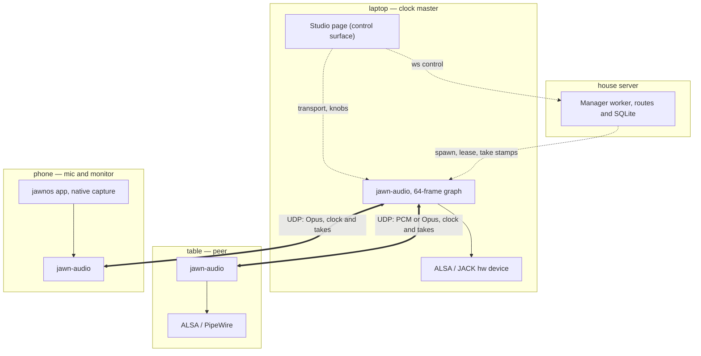

# Studio audio engine — a native low-latency engine for multitrack

> **Entry point:** `docs/roadmap.md`. This plan is **proposed, not started**; P0 is the gate that
> decides whether the rest is worth building. It is not on this season's critical path.

**Status:** proposal, 2026-11-17. No code written. P0 (measure) is the next action.
**Related:** `docs/reception.md` (the audio gateway the engine must not duplicate),
`docs/platform-roadmap.md` (CoreAudio/WASAPI — the same device seam), `docs/roadmap.md` (Perl stays
the server), `docs/docker.md` (what the container deliberately lacks).

---

## 1. Charter

> Give Studio one native audio process per machine that owns the sound card, mixes and records at a
> fixed small buffer, and shares one sample clock with the other machines — so a take made on the
> phone, the laptop and the table lines up sample-for-sample, and monitoring is played, not
> perceived.

What that buys, in order:

1. **Monitoring you can play to.** A fixed 5 ms is playable; the browser's variable 30–60 ms is not.
2. **Takes that are in time.** The click, the take and a remote take share one clock, so a
   multitrack is aligned by construction instead of by nudging.
3. **The phone as a microphone** (and a monitor), over the tailnet, with the same guarantee.
4. **One audio stack for the house** — Studio, recording the reception call, video timelines and
   plain file work share the engine instead of three different pipelines.

---

## 2. Why the browser cannot be fixed

This is architecture, not opinion. Four costs stack in the current path:

| Cost | Where | Why it cannot be tuned away |
|---|---|---|
| Device buffer | `studioLatencyHint` (`public/js/manager/studio.js:111`) | `latencyHint` is a **request**. Chromium picks the real buffer in its audio service, after the OS mixer. A number there does not reach the hardware. |
| Capture | `MediaRecorder` (`public/js/manager/studio/05_inputs.js:346`) | `start()` is called with no timeslice, so the take is a blob that arrives at `stop`. Its start is a wall-clock event, not a sample position. |
| Alignment | `studioRecordOffset` (`public/js/manager/studio/03_editing.js:1`) | The code already subtracts a *measured* latency to keep an overdub from landing late. That is the right idea applied to the wrong transport: an estimate nudging a recording whose true start is unknown. |
| Round trip | the app's own probe (`public/js/manager/studio.js:421`) | Monitoring leaves the graph, crosses the audio service and the OS mixer and comes back. |
| The owner | Qt WebEngine (desktop) / Chromium | The browser holds the device handle. No JavaScript gets exclusive access to it. |

The lesson from Cubase and Kristal is exactly this: the win came from owning the device (ASIO), not
from a better mixer. That is a process-boundary change, and nothing inside the page substitutes for
it.

Playback is the part already done right: takes are scheduled on the `AudioContext` clock
(`public/js/manager/studio/01_transport.js:140`), which is why playback is stable and recording is
not.

That probe at `studio.js:421` is also the first asset this plan reuses: P0 does not have to invent a
latency meter, it has one.

---

## 3. What "0 latency" can honestly mean

"Zero" is not achievable. Three different problems wear that word and they need different answers.

- **Latency** — the fixed delay. Target: **≤ 5 ms** round trip, wired, at 48 kHz / 64 frames
  (1.33 ms per block: capture + graph + output).
- **Jitter** — the variable part. A fixed 6 ms is playable; 6 ms ± 30 is not. Target: **no audible
  jitter**, because the buffer never underruns. The xrun count becomes a first-class readout.
- **Drift** — two crystals differ by ~50–200 ppm: 2.6–10 ms a minute. Target: **± 1 sample** after
  compensation, which means resampling every input to one master clock, not trusting both.

The network floor, measured against what Music already does: the remote path runs PCM at a 30 ms
pacat buffer (`perl/Music/01_remote_audio_receiver.pl:264`) with an 80 ms latency base
(`perl/Music/04_music_websockets.pl:220`), because it carries a *stream*, not a session. On a LAN the
same samples can arrive in **one or two frames (~3 ms)**. That 10× is what the ask is really about.

---

## 4. Decisions

| # | Decision | Why |
|---|---|---|
| D1 | **A native helper, not a server rewrite.** A Rust binary, built per machine, optional. | Follows `perl/sco/sco_helper` and `scripts/build_sco.pl`: the one part that must live outside Perl, absent where it cannot be built. Consistent with this season's "Perl stays the server" (`docs/roadmap.md`). |
| D2 | **Perl keeps every record; the engine keeps every sample.** Songs, takes, clips, settings, peers and permissions stay in SQLite and the routes. | The engine is replaceable and crashable. Nothing durable lives only in its memory. |
| D3 | **One engine per machine, opt-in.** Spawned when Studio arms, asleep when it does not. | A 64-frame engine wakes 750×/s — the opposite of the battery target. It must cost nothing when idle. |
| D4 | **Audio over UDP directly; control over the existing websocket.** | The ws path already authenticates peers (`peer_verify` + `signatorial`, as `/manager/music/stream` does). Datagrams carry samples; a TCP hop is a jitter source by definition. |
| D5 | **One clock master per session; every take is stamped with the master's sample position.** | This is what makes remote multitrack line up. Offset and drift are estimated from timestamped datagrams. |
| D6 | **PCM on a wired LAN, Opus for the phone and Wi-Fi.** | PCM is free on a gigabit; Opus at 10 ms frames keeps a phone's uplink honest. Chosen per peer and stream, not house-wide. |
| D7 | **Graceful fallback, always.** No engine → today's WebAudio path, unchanged. | A machine that cannot build it is a machine with the studio it has now. |
| D8 | **The engine is a channel, not a silo.** It can expose and consume the reception handset's `jawn_call_in` / `jawn_prompt` (`lib/JawnOS/Sco/Mixer.pm:39`). | Recording a screened call and monitoring a caller become two more channels instead of a second audio stack. |

---

## 5. Target topology



The browser becomes a **control surface and a picture**, never a sample path. That is the whole
change in one sentence.

---

## 6. The protocol, in outline

One small fixed header per datagram, then the payload:

```
magic | version | session | stream | seq | master_sample | codec | flags | payload
```

- `session` is issued by the manager when Studio arms, so a stale peer cannot join.
- `stream` names one input or one bus: `ch3-in`, `master`, `click`.
- `seq` detects loss and reordering; `master_sample` is the position of the **first** sample, so the
  receiver places it on the timeline without trusting arrival time.
- `codec` is `pcm_s16`, `pcm_s24` or `opus10` (10 ms).
- Authentication comes from the existing peer handshake (house CA + `peer_verify`); every datagram
  carries a short MAC. Never an open UDP port.

Loss policy differs per stream, and that is a feature: an **input** stream conceals (repeat and fade)
because a missing guitar sample is better than a gap; a **bus** stream drops stale audio rather than
playing late — the rule the Music receiver already applies (`perl/Music/02_remote_audio_stream.pl:205`).

---

## 7. Phases

Each phase has one gate. A gate that fails is a finding, not a setback: it changes the phase after
it.

### P0 — Measure before building (2–3 days)

Instrument what Studio does *now*, on the laptop and the table: capture-to-graph latency, output
latency, `MediaRecorder` start error against the click, and take alignment on playback. Reuse the
probe at `studio.js:421`. Record the numbers here or in a short baseline section beside it.

**Gate:** a table of measured numbers and a target the native path must beat by at least 4×. If the
browser is already at 12 ms on this hardware, the engine's case is weaker and this doc says so.

### P1 — The engine skeleton (1 week, spike)

An `engine/` Cargo workspace and the `jawn-audio` binary: open a device, pass 2 in / 2 out through,
report xruns and the measured round trip on a Unix socket under `~/.president/`.
`scripts/build_engine.pl` mirrors `build_sco.pl` (build, `--check`, no compiler → no engine); the
binary is gitignored beside `perl/sco/sco_helper`.

**Gate:** ≤ 5 ms round trip at 64 frames, zero xruns over 10 minutes, and a null backend that runs in
the suite.

### P2 — Studio's graph in the engine (2–3 weeks)

Channels, gain/pan, the tone stack, the pedal inserts, the click, the transport, and takes written as
WAV/FLAC on disk (the DB keeps the take row as today). The page keeps the waveform canvas and the
knobs and calls the engine; `JawnOS::Audio::Engine` is the Perl-side client.

**Gate:** a four-track take recorded through the engine lands within **±1 sample** of the click on
playback, and an A/B against the current path is indistinguishable except for latency.

### P3 — Peers on one clock (2 weeks)

Engine-to-engine over UDP: one master, one peer, one shared transport. Offset and drift estimated
from timestamped datagrams, inputs resampled to the master. This is where the hard problem lives.

**Gate:** two machines, ten minutes, drift **< 1 sample** without an audible correction, LAN
monitoring **< 15 ms**.

### P4 — Track from another room (2 weeks)

The uplink proper: a peer's input becomes a channel on the master, latency-compensated so the take
lands where the player played it. First peer is a laptop on the LAN, second is the phone.

**Gate:** guitar on the laptop and voice on the phone in one session, both in time with the click,
both on the same take, ten minutes without a lost take.

### P5 — Picture and general audio (open-ended, last)

The timeline gains video: ffmpeg decodes to the engine's clock, the preview is a native surface (or
the canvas), renders go back through ffmpeg. Also the boring wins: format conversion, normalisation,
a render queue, a level meter that is true. No codec is written here.

**Gate:** a two-camera take with a clean audio master exported end-to-end, picture within one frame of
the timeline.

### P6 — Other platforms

CoreAudio and WASAPI behind the same device trait — the seam `docs/platform-roadmap.md` P2/P3 opens.
Deliberately last: one excellent Linux engine beats three mediocre ones.

---

## 8. The phone as a microphone

The app is a Termux fork that already supervises jawnos and already owns call audio
(`JawnInCallService`). The microphone path belongs in the app's Java layer, not in the web page:

1. A foreground service holding an `AudioRecord` on **AAudio/Oboe** with
   `PERFORMANCE_MODE_LOW_LATENCY` (and exclusive mode where the device allows it), 48 kHz mono.
2. 10 ms Opus frames over the same UDP protocol, addressed by a **mic lease** the manager issues, so
   the phone knows which session and which channel to feed.
3. The same engine binary on `aarch64-linux-android` can mix the phone's own monitoring, but it is not
   required for P4 — capture plus the phone's existing speaker path is enough to be a microphone.
4. `getUserMedia` in the phone's browser stays the fallback (it is what works today, and what P0
   measures against).

The app rule stands: any APK change bumps `versionCode`/`versionName` and is built and published in
the same change (`~/jawnos-app/termux-app/AGENTS.md`).

---

## 9. Risks

| Risk | Why it bites | Mitigation |
|---|---|---|
| **Clock drift** | The whole remote-multitrack promise; two crystals never agree. | Estimate offset *and* drift from the first datagrams; resample inputs to the master; stamp takes with master positions. Design it in P1, not P4. |
| **Power vs. latency** | 750 wakeups/s contradicts the idle target in `docs/roadmap.md`. | Opt-in and arming-scoped; the engine exits when the session ends. Report energy per armed hour. |
| **Bluetooth monitoring** | 150–300 ms whatever the engine does. | Refuse it for monitoring and say so; `docs/reception.md` already knows the 2.4 GHz/Bluetooth interference story. |
| **Realtime scheduling** | Without `rtprio`/`memlock` limits (or PipeWire's RT), the engine xruns under load. | Provision `@audio` limits, document per distro, and report the limit rather than degrading silently. |
| **Security of the uplink** | An open UDP port on the house LAN is a microphone for anyone. | Session keys from the peer handshake, a per-datagram MAC, lease expiry; never a house-wide open port. |
| **CI cannot hear** | A suite with no sound card. | Null backend plus a deterministic clock; unit-test the graph and the sync maths against fixtures. Every behaviour change gets its `t/` file with `# tests-for:`. |
| **The engine becomes a server** | Scope creep into playback libraries, transcode queues, a second DB. | D2: Perl keeps every record; video stays ffmpeg. |
| **Duplicating reception** | Two audio stacks fighting over PipeWire. | D8: the engine is another channel on the existing handset, never a second gateway. |

---

## 10. Non-goals

- No rewrite of Studio's UI; the canvas, waveform and knobs stay, they just stop making sound.
- No VST/AU host. Pedals stay the house's own effects; an insert can be an external process later.
- No video codec, no NLE feature race. Picture follows the audio clock, nothing more.
- No engine in the Docker image — a container has no sound card, and `docs/docker.md` already lists
  what it deliberately lacks.
- No engine on machines that only listen; the browser receiver path stays.

## 11. Open questions

1. **ALSA `hw:` exclusive, JACK, or PipeWire's client API?** Raw ALSA gives the smallest buffer but
   owns the device; JACK composes with what runs; PipeWire is what the house already uses. P1 should
   answer with a number, not a preference.
2. **f32 or f64 internally?** f64 is the house's habit in Perl; f32 is what the hardware and the SIMD
   want. Decide at P2 and write it down.
3. **Where does the transport live** when the browser is only a view — the master machine's engine, or
   the session's clock master even when the UI is elsewhere?
4. **One engine per machine or per user?** A shared box with two people in Studio needs two graphs.
5. **What is the honest wired monitoring number on the oldest laptop?** P0 decides whether 5 ms is
   credible or 8 ms is the truthful target.

## 12. First week, concretely

1. P0 instrumentation: `performance.now()` around `getUserMedia`, `ctx.baseLatency` +
   `ctx.outputLatency`, `MediaRecorder` start error against the click, take alignment on replay — the
   probe at `studio.js:421` already does the round trip.
2. A short baseline section with the numbers and the machine each came from.
3. `cargo new engine --bin jawn-audio` and a null backend that runs in the suite, so P1 starts from a
   green test rather than a device.
