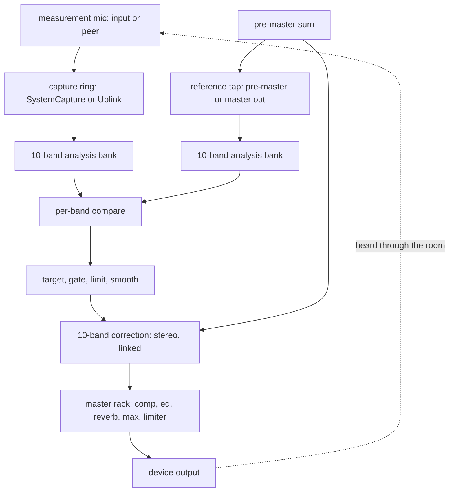

# Mastering automation — a measurement mic on the master

> **Status:** design only, 2026-11-24. Nothing in this file is built. The first
> slice is browser-only; the engine section names the taps that exist and the
> ones that do not.

**Short answer.** A microphone can hear the master playback and a 10-band
correction can follow it. This tree cannot do it *during playback* yet, and the
reasons are specific:

- The Studio transport owns the output, and it has no capture of its own and no
  analyzer (`engine/src/playback.rs:1371-1395`).
- The patchbay does capture, but the transport and the patchbay are mutually
  exclusive: `patch` refuses while the transport plays
  (`engine/src/socket.rs:2587-2593`) and `transport start` refuses while a patch
  runs (`engine/src/socket.rs:3896-3901`).
- The patchbay has no master rack at all. `SourceRoute` is only `Bus` or `Sink`
  (`engine/src/patchbay.rs:77-84`).
- The master rack's EQ is now **ten bands**: `master_eq` is the `GraphicEq`
  (32 / 64 / 125 / 250 / 500 Hz and 1 / 2 / 4 / 8 / 16 kHz, ±12 dB,
  `engine/src/effect/graphic_eq.rs`; the browser mirrors it in
  `public/js/manager/studio/08_effects.js`). The first slice writes those ten
  bands; it does not need a second EQ just for automation.

The first useful slice is therefore the browser, where the master chain
(`public/js/manager/studio/10_master.js:25-39`) and `getUserMedia`
(`public/js/manager/studio/05_inputs.js:714-718`) already exist, and where no
engine change is needed.

---

## 1. What the brief assumes, and what the tree has

| The brief says | The tree has | What the design does |
| --- | --- | --- |
| A local mic is a `device` source | `device` is the machine's **system mix** (`engine/src/patchbay.rs:122`); a local capture channel is `input` (`:69`; `lib/JawnOS/Audio/Plan.pm:26`) | A local measurement mic is an `input` source with a `node` (a PipeWire source name). `device` is not a microphone. |
| The master EQ has ten bands | `master_eq` is the ten-band `GraphicEq` (`engine/src/effect/graphic_eq.rs`), with the same ten controls in the browser (`public/js/manager/studio/08_effects.js`) | The automation writes those ten bands; no new EQ row is needed. The new part is the analyzer stage. |
| The mic is routed to an analyzer | `SourceRoute` is only `Bus` or `Sink` (`engine/src/patchbay.rs:77-84`); an unrouted source is skipped (`:1556`) | Add an analyzer tap: a source marked for measurement, with no bus or sink edge. |
| The loop runs during master playback | The transport has no capture; only a take's live ring can be attached (`engine/src/playback.rs:1559-1569`) | The measurement path belongs in the transport, not the patchbay. This is the main new plumbing. |
| A `mastering` plan section | `audio_plan_normalize` returns only `sources`, `buses`, `sinks`, `routes` (`lib/JawnOS/Audio/Plan.pm:404-494`) | Put `mastering` in the **transport plan** and the song, not the house audio plan. The audio plan carries only the mic **source**. |

The distinction matters: the rest of this document is about a loop that can
actually close, not a drawing of one.

---

## 2. Signal flow



### 2.1 The taps

| Tap | What it carries | Where it lives | State |
| --- | --- | --- | --- |
| Pre-master | Every take, app bus and live input summed **before** the master rack | `TransportSource::pre_master` (`engine/src/playback.rs:1430-1434`), copied to `out` and then `mixer.run_master` (`:2479-2483`) | Exists as an audio-thread buffer. Nothing exposes it to a control thread or an analyzer. |
| Post-master | The electrical signal leaving the master rack | `out` immediately after `run_master` (`engine/src/playback.rs:2480-2483`), before the click (`:2485-2489`) | Exists as a buffer. Not exposed. |
| Bus (house patch) | One bus after its sends, before it is balanced into a sink | `Patchbay::render` (`engine/src/patchbay.rs:1806-1810`) | Exists as the **bus take's** single WAV tap; it is a `Producer`, not an analyzer. |
| Mic, local | One capture channel or a named PipeWire source | `SystemCapture::start_channel` (`engine/src/system_capture.rs:100-112`), `parec` at 20 ms (`:37`, `:314-324`) | Exists for the patchbay. Not usable by the transport today. |
| Mic, peer | A phone's uplink ring | `UplinkSource` (`engine/src/uplink.rs:316-361`), started by `Uplink::start` (`:761-820`) | Exists for a patch. Not started for a transport. |
| Sink | The interface / speakers / zone | `Patchbay::render` sums every sink (`engine/src/patchbay.rs:1828-1833`) | Exists. The measurement mic must **never** reach here. |

The reference and the mic do not need to be sample-aligned. This is a magnitude
measurement: each band's level is averaged over 1–2 s, which is far longer than
a peer's 85–500 ms buffer or a phone's declared latency. What must be true is
that both streams carry the **same programme** over the same window. A seek, a
loop wrap or a song change breaks that; the design resets or freezes on each.

### 2.2 What the engine already exposes

| Fact | Where |
| --- | --- |
| Source kinds (`input`, `player`, `peer`, `handset`, `device`) | `engine/src/patchbay.rs:69`; `lib/JawnOS/Audio/Plan.pm:26` |
| A source's own gain, mute and insert chain | `engine/src/patchbay.rs:99-150`, `:1551-1598` |
| A peer source's declared latency and read buffer | `engine/src/patchbay.rs:137-147`; `engine/src/uplink.rs:152-195` |
| The master rack's order and knobs | `engine/src/mixer.rs:342-348`; `Mixer::set_master` `:558`; `Mixer::run_master` `:917-952` |
| The transport's master rack and values | `TransportSource::master` / `master_values` (`engine/src/playback.rs:1376-1381`); `TransportPlan` (`:1264-1286`) |
| The pre-master sum and the one mastering pass | `engine/src/playback.rs:2337-2483` |
| The transport's only input edge (a take's live monitor) | `engine/src/playback.rs:1559-1569`; `run_transport` arguments (`engine/src/socket.rs:6625-6650`) |
| The engine's one-line status | `engine/src/socket.rs:4427`; transport fragment `:6563-6607` |
| The manager's engine command path | `JawnOS::Audio::Engine::audio_engine_command` (`lib/JawnOS/Audio/Engine.pm:141`) |
| The Studio post that fronts the engine | `POST /manager/studio/take` (`lib/JawnOS/Routes/manager_misc9.pm:49`), `action_44023` (`lib/JawnOS/Controller/manager_misc9.pm:1356`) |

### 2.3 The gaps, named

| Need | Where it would live | Today |
| --- | --- | --- |
| A ten-band correction EQ | Reuse the ten-band `master_eq` (`GraphicEq`) as the correction target; the new part is the analyzer stage, not an EQ. The rack is the fixed master order in `engine/src/mixer.rs`. |
| An analyzer route | `SourceRoute` in `engine/src/patchbay.rs:77-84` | Missing: only `Bus` and `Sink` exist. |
| An analyzer source flag | `Source` (`engine/src/patchbay.rs:99-150`) and `_audio_plan_node` (`lib/JawnOS/Audio/Plan.pm:263-346`) | Missing. An unrouted source costs no ring and is skipped (`engine/src/patchbay.rs:1556`). |
| A mic ring on the transport | `TransportSource` (`engine/src/playback.rs:1371-1395`), `run_transport` (`engine/src/socket.rs:6625-6650`) | Missing. The transport can only take a **take's** live ring. |
| A reference tap the analyzer can read | `pre_master` / `out` (`engine/src/playback.rs:2479-2483`) | The buffers exist; no handle, no ring, no socket object. |
| A peer uplink for the transport | `Uplink::start` (`engine/src/uplink.rs:761-820`) | The uplink starts inside the patch worker (`engine/src/socket.rs:1313-1434`), not for a transport. |
| `mastering` in the status | `engine/src/socket.rs:4427` | Missing. |
| A manager route | Beside `lib/JawnOS/Routes/manager_misc9.pm:49-53` | Missing. |

---

## 3. DSP

### 3.1 The filter bank

Ten one-octave peaking sections at the ISO centres. The correction bank and the
analysis bank share the frequencies; the correction bank **is** the 10-band
master EQ, so a measured curve and an applied curve are the same shape.

| # | Hz | Analysis | Correction | Note |
| --- | --- | --- | --- | --- |
| 1 | 32 | bandpass, Q 1.41 | peaking, Q 1.41 | The low bands are the ones a phone mic and a room mode lie about; cap them tighter (§6). |
| 2 | 64 | same | same | |
| 3 | 125 | same | same | |
| 4 | 250 | same | same | |
| 5 | 500 | same | same | |
| 6 | 1k | same | same | |
| 7 | 2k | same | same | |
| 8 | 4k | same | same | |
| 9 | 8k | same | same | |
| 10 | 16k | same | same | At 48 kHz this is below Nyquist; a 44.1 kHz session still works, but the top band is narrower. |

Use the existing RBJ `peaking` helper (`engine/src/effect.rs:190-202`) and
`Biquad` (`:119-171`). A band bank is cheaper than an FFT: twenty biquads per
block (ten for the mono mic, ten for the mono reference) plus twenty for the
stereo correction, with no window, no frame latency and no bin-to-band
integration. The 3-band `Equalizer` already proves the coefficient path; this
is the same code with ten sections.

Why not an FFT, even though the browser slice uses one: an FFT gives bins, not
the EQ's bands, so a 1024-point transform still needs ten weighted sums; its
window is a latency and a smear; and the correction coefficients would then be
designed from a spectrum that does not match the filters. The filter bank and
the EQ are the same ten shapes, so "what was measured" and "what was applied"
cannot drift apart. The browser slice uses `AnalyserNode` because it is one
node and ten seconds of audio, not because it is the model.

### 3.2 Envelopes, gate and freeze

Per band, on both streams:

```
e = (1 - a) * e + a * x * x        attack 50 ms, release 500 ms
level_db = 10 * log10(e + 1e-12)
```

The fast envelope drives the meters. The correction reads a 1.5 s mean of the
same envelope (`smooth_ms`, default 1500, range 500–5000).

| Condition | Behaviour |
| --- | --- |
| A reference band is below −50 dBFS | Hold that band's correction; it has no programme to measure. |
| A reference band is 20 dB below its own 10 s maximum | Hold that band. A quiet band's ratio is noise. |
| The whole reference is below −55 dBFS for 200 ms | Freeze all bands; say `gate: "quiet"`. |
| Fewer than 50% of a Learn window is above the gate | Refuse the Learn: "the programme was too quiet to learn from." |
| No mic frames for 2 s | Freeze; `stale: true`. |
| No mic frames for 30 s | Fade the auto bands to 0 dB over 500 ms; `state: "stale"`. The manual rack is untouched. |
| The transport stops | Freeze. The transport thread ends, so the loop ends with it. |
| A seek, loop wrap, clip replacement or song change | Reset the auto bands to the song's saved value (or 0). A 100 ms fade, not a step. |

### 3.3 The correction

Work in dB, per band. Let

- `R_b` be the reference band level (pre-master),
- `M_b` be the mic band level (the same programme through the room and the mic),
- `E_b` be the **current** auto-EQ gain for that band,
- `T_b` be the target for that band.

`M_b - R_b` already contains the current `E_b`, because the mic hears the
post-EQ output. The measured deviation from target is

```
D_b = (M_b - R_b) - T_b
```

and one update moves the auto EQ by

```
E_b' = clamp(E_b - g * D_b, -limit_db, +limit_db)
```

with `g = 1.0` for a Learn (one correction at the end) and `g = 0.15` for
Active (one update every `smooth_ms`). The sign is the whole thing: a band the
mic hears louder than the target is **cut**. Starting from `E_b = 0` and
running the loop once gives `E_b = T_b - (M_b - R_b)`; running it again with the
new `E_b` in the path measures only what is left. A loop gain below 1 is what
keeps a room reflection or a phone's own resonance from being chased into a
boost.

The reference has to be the bus **before** the EQ for this form to be exact.
That is the brief's choice and it is implementable: `pre_master` is the bus, and
the auto EQ is a stage on the way to `run_master`. If the engine later exposes
the **post**-master output as the reference, the current `E_b` is already inside
the reference, `M_b - R_b` becomes the acoustic transfer alone, and the update
is `E_b' = E_b + g * (T_b - (M_b - R_b))`. Both forms are correct; do not mix
them.

The manual `master_eq` is the same ten-band stage the automation writes. If a
person turns a band while the automation is armed, the loop treats that change
as a manual target offset unless the page hands the band back to the loop; the
UI therefore marks the automated bands and offers **Take** and **Release**. The
default is: **the auto EQ owns the ten `master_eq` bands while it is armed; the
person's manual curve is stored beside them and restored on Reset.** The song
stores both so the person can compare them.

### 3.4 The target curve

A flat target at the microphone is not a flat room. Room gain at the low end and
air absorption at the top make a genuinely flat measurement sound thin; a
gentle downward tilt is what a person hears as balanced. Ship two targets:

| Band | Flat | House |
| --- | --- | --- |
| 32 | 0.0 | +3.0 |
| 64 | 0.0 | +2.0 |
| 125 | 0.0 | +1.0 |
| 250 | 0.0 | +0.5 |
| 500 | 0.0 | 0.0 |
| 1k | 0.0 | 0.0 |
| 2k | 0.0 | −0.5 |
| 4k | 0.0 | −1.0 |
| 8k | 0.0 | −1.5 |
| 16k | 0.0 | −2.0 |

`House` is the default for a PA in a room; `Flat` is for a calibrated
measurement mic in a treated room, where the person is measuring the system
rather than the house's taste. The target is a choice, not a truth, and the page
shows it as a line rather than hiding it.

### 3.5 The mic is not the room

These are three different things and the design must not merge them:

1. **The mic's own response.** A measurement mic is close to flat and comes
   with a calibration file; a phone mic is neither, and its response changes
   with the case, the hand and the orientation. A phone's curve is baked into
   `M_b` and therefore into the correction.
2. **The room's modes.** They are narrow (a 40 Hz mode is far narrower than a
   1.41-Q octave band), position-dependent, and change when people arrive. Ten
   octave bands cannot resolve one; they correct broad balance.
3. **The system's voicing.** The house may deliberately want a tilt, a bass
   lift or a bright top. That is the target curve, not an error.

So the honest claim is: *this makes the broad tonal balance at one microphone
match a chosen curve.* It is not room correction, it is not a substitute for
moving a speaker, and a phone's result is the phone's idea of the room.

---

## 4. Modes and the UI

| Mode | What it does | Ends |
| --- | --- | --- |
| Off | Auto bands are 0 dB; the manual rack is untouched. | — |
| Learn | Measures for `seconds` (default 10, range 5–60), computes one correction, fades it in over 500 ms. | The timer, Stop, a quiet gate refusal, or the transport stopping. |
| Active | Repeats the measurement every `smooth_ms` and moves by `g = 0.15` of the error. Freezes on a quiet gate. | Stop, transport stop, 30 s stale, or an engine error. |
| Reset | Fades the auto bands to 0 dB over 500 ms. The manual rack is untouched. | Immediate. |

The block sits in the master strip, above the rack, because that is where the
person already looks for the master (`templates/studio/markup.html.ep:293-301`;
`perl/gb/05_abilities_and_studio.pl:310-339`). It carries:

- **Mic**: a picker of this machine's `input` sources and the plan's `peer`
  sources. No free-text device path; a `node` is a name from the plan.
- **Learn / Active / Reset**, and a state line (`off`, `learning`, `active`,
  `frozen`, `stale`).
- **Target**: Flat or House; the curve is drawn.
- **Ten before/after bars**: measured `M_b - R_b` (before) and the applied
  `E_b` (after), with the target line between them. The bars are the honest
  picture; a single "auto" lamp is not.
- **Limit** (±6 dB) and **Smooth** (1.5 s), only while a person is learning the
  feature.
- The existing manual `master_eq` remains below it; the page says when the two
  are both on and what that means.

The ten-band auto EQ is drawn as ten narrow sliders in the same block, not as a
sixth pedal. The rack is a fixed contract of five inserts
(`engine/src/mixer.rs:342-348`; `docs/studio-effects.md:96-107`); making the
auto EQ a sixth `InsertKind` would change the socket vocabulary, the browser
mirror, the plan and the tests for a control loop that is not a pedal. If the
house later wants a manual ten-band EQ as well, that is a separate contract
change and this block can drive it.

---

## 5. Engine and API

### 5.1 The plan section

The `mastering` section travels with the **transport** plan and is saved with the
song, beside `master` (`public/js/manager/studio/10_master.js:185-193`). It is
not in the house audio plan, because `audio_plan_normalize` returns four lists
and would drop it (`lib/JawnOS/Audio/Plan.pm:404-494`). The audio plan carries
only the mic **source**.

```json
"mastering": {
  "mic": "measure",
  "reference": "pre_master",
  "mode": "learn",
  "target": "house",
  "bands": [0, 0, 0, 0, 0, 0, 0, 0, 0, 0],
  "limit_db": 6,
  "smooth_ms": 1500,
  "seconds": 10
}
```

| Field | Meaning | Bounds |
| --- | --- | --- |
| `mic` | The plan source id of the measurement mic | An `input` or `peer` source on this machine / a declared peer; never a sink |
| `reference` | Which tap the analyzer compares against | `pre_master` today; `post_master` if the engine exposes the output tap |
| `mode` | `off`, `learn`, `active` | one of the three |
| `target` | `flat` or `house` | one of the two |
| `bands` | The ten auto-EQ gains in dB, bass to treble | −6..+6 each; ten finite numbers |
| `limit_db` | The per-band clamp | 0..6 |
| `smooth_ms` | The correction window and Active's update interval | 500..5000 |
| `seconds` | Learn's window | 5..60 |

The mic source is a normal plan source with one new flag:

```json
{ "id": "measure", "kind": "input", "machine": "table",
  "channel": 1, "node": "alsa_input.usb-BEHRINGER_UMC202HD", "analyzer": 1 }
```

or, for a phone:

```json
{ "id": "phone_mic", "kind": "peer", "machine": "phone",
  "latency_ms": 150, "buffer_ms": 150, "analyzer": 1 }
```

`analyzer: 1` means: compile a capture for this source, hand it to the
`mastering` block, and never give it a bus or sink edge. The analyzer edge is
`mastering.mic` -> the `mastering` block; it is deliberately not a `routes`
row, because every `routes` row ends at a bus or a sink. `_audio_plan_node`
must keep the flag, and `audio_plan_valid` must refuse a route from an
`analyzer` source to anything (`lib/JawnOS/Audio/Plan.pm:263-346`, `:608-679`).
That refusal is the feedback guard at the plan level.

### 5.2 The manager route

`POST /manager/studio/mastering`, a sibling of the Studio post at
`lib/JawnOS/Routes/manager_misc9.pm:49-53`, shaped like `action_44023`
(`lib/JawnOS/Controller/manager_misc9.pm:1356-1450`). It validates every field
before it dials the engine and then relays
`JawnOS::Audio::Engine::audio_engine_command` (`lib/JawnOS/Audio/Engine.pm:141`).

| `action` | Fields | Refuses |
| --- | --- | --- |
| `start` | `mic`, `mode` (`learn`/`active`), `seconds`, `target`, `limit_db`, `smooth_ms` | an unknown mic; a mic that is not `input`/`peer`; a mic routed to a bus or sink; no transport; a take recording; a second Learn |
| `stop` | — | nothing; idempotent |
| `status` | — | nothing; relays the engine's object, including "no transport" |
| `bands` | `bands_json`, ten numbers | a wrong length, a non-finite value, a value outside ±6 |
| `reset` | — | nothing |

The route does not compute the correction and does not write the database. The
engine computes it; the page saves the learned `bands` with the song. That keeps
one authority for the loop and one for the song document.

### 5.3 The socket command and status

```json
{"cmd":"mastering","action":"start","mic":"measure","mode":"learn",
 "seconds":10,"target":"house","limit_db":6,"smooth_ms":1500}
{"cmd":"mastering","action":"status"}
{"cmd":"mastering","action":"bands","bands":[0,0,0,0,0,0,0,0,0,0]}
{"cmd":"mastering","action":"stop"}
```

`status` carries one object beside the transport's own fields:

| Field | Meaning |
| --- | --- |
| `state` | `off`, `learning`, `active`, `frozen`, `stale` |
| `mic`, `kind`, `machine`, `node` | The source the loop is listening to |
| `reference` | `pre_master` (or `post_master` if the tap changes) |
| `mode`, `target` | What was asked for |
| `progress`, `seconds_left` | Learn's clock |
| `bands` | The applied ten gains, dB |
| `measured` | The last `M_b - R_b`, dB |
| `target_db` | The target curve the page draws |
| `limit_db`, `smooth_ms` | The clamps in force |
| `gate` | `open`, `held` or `quiet` |
| `stale` | True when the measurement is older than 2 s |
| `error` | The sentence when a Learn was refused or the mic died |

The transport status is already one JSON line (`engine/src/socket.rs:4427`);
add `mastering` to the transport fragment (`:6563-6607`) or to the patch line,
the same way `transport` rides a take's line. The page already polls the
transport every 250 ms (`public/js/manager/studio/01_transport.js:862-865`), so
the bars need no second poll.

### 5.4 Starting the mic

- **Local**: the plan's `node` and `channel` go to
  `SystemCapture::start_channel` (`engine/src/system_capture.rs:100-112`), which
  runs `parec` at 20 ms (`:37`, `:314-324`). The consumer is attached to the
  transport through a new edge shaped like the take's live edge
  (`TransportLive`, `engine/src/playback.rs:1559-1569`;
  `socket.rs:3942-3947`).
- **Peer**: the plan's `peer` source goes to `Uplink::start`
  (`engine/src/uplink.rs:761-820`) with an `UplinkSourceSpec`
  (`:730-744`). The manager issues the mic lease the roadmap names
  (`docs/studio-audio-roadmap.md:684-692`). The uplink is started for the
  transport, not only inside the patch worker (`engine/src/socket.rs:1313-1434`).

The peer's `latency_ms` is a **placement** fact (`engine/src/uplink.rs:152-170`),
and it does not matter for a magnitude measurement. The peer's `buffer_ms` only
delays the mic relative to the reference; a 1.5 s window absorbs it. The phone's
own microphone response **does** matter, and no amount of latency correction
fixes it.

---

## 6. Safety

| Risk | Control |
| --- | --- |
| The mic is routed to a sink and the room howls | An `analyzer` source has no bus or sink edge. `audio_plan_valid` refuses one; the engine compiles an analyzer tap, never a route. The page never connects the mic to `ctx.destination`. |
| The mic is also a live monitor | Refuse `listen` on the measurement input while `mastering` runs. The engine already serialises listen, take and patch; extend that rule to the loop. |
| A boost drives the room into feedback | ±6 dB per band, a separate **+6 dB total positive budget**, and ±3 dB below 125 Hz. Cuts are trusted; boosts are not. The limiter is after the auto EQ, so it catches the level, not the feedback. |
| The loop chases a reflection | `g = 0.15` in Active, a 1.5 s window, and a gate that holds any band without programme. A null is a cut the loop cannot fix; do not boost into it. |
| One mic corrects a stereo image | The mic is mono and the correction is stereo-linked: the same `E_b` on left and right. Never derive a per-channel correction from one microphone. |
| A phone is not a measurement mic | No calibration, AGC/NS/AEC off (`public/js/manager/studio/05_inputs.js:714-718`), the phone held still and away from the speakers. The result is labelled as the phone's curve, not a calibrated measurement. |
| The measurement is stale | Freeze at 2 s, fade to 0 dB at 30 s, `state: "stale"`. The manual rack and the person's saved curve are untouched. |
| The loop fights the manual EQ | The auto EQ writes the ten `master_eq` bands; while it is armed the page marks them automated, and **Release** hands them back to the person's stored curve. The page says when both are on. |
| A take is recording | Do not run Active while a take records on the same machine. Learn may run beside a take only if the backend grants a second capture; otherwise refuse by name. |
| The song changes under the curve | The learned curve is saved with the song. A new song loads its own `bands` (or 0) and resets the loop. A seek or a clip change resets the integrator. |

The fail-safe is one sentence: **any error, stale measurement or missing mic
leaves the manual master rack exactly as it was and puts the auto bands at
0 dB.** The loop never gets to leave the master in a state the person cannot see.

---

## 7. The first slice, and the phases

### 7.1 Browser-only Learn (no engine change)

The browser already owns the master chain and the microphone permission:

1. `studioContext()` builds the `AudioContext` (`public/js/manager/studio.js:75-85`);
   `studioMasterChain` builds the rack and exposes `input` and `output`
   (`public/js/manager/studio/10_master.js:25-39`).
2. Tap `masterChain.input` (pre-master) into an `AnalyserNode`; tap the chosen
   mic (`getUserMedia`, constraints at
   `public/js/manager/studio/05_inputs.js:714-718`) into a second
   `AnalyserNode`. Neither node reaches `destination`.
3. Run for 10 s. Average the power in each of the ten octave bands (sum the FFT
   bins, not one bin per band). Gate each band as §3.2.
4. `D_b = (M_b - R_b) - T_b`; `E_b = clamp(-D_b, -6, +6)`. Write the ten
   `master_eq` band controls (`b32`…`b16k`) through the existing
   `studioEffectMasterEq` builder and save the learned `bands` in the song's
   master record (`10_master.js:185-193`). If the page wants to keep the
   learned curve separate from the person's manual curve, it stores the
   manual values first and restores them on Reset.
5. Show the mic picker, Learn/Reset, the ten before/after bars and the target
   line. Learn is one-shot; Active is not in this slice.

This proves the microphone, the target, the gate, the bars and the save, on the
machine the person is already using. It does **not** prove the engine's filter
bank, the transport's capture, the peer, or a continuous loop. The browser's
`AnalyserNode` is an FFT and the engine's production path is a filter bank; the
two will agree in broad shape, not sample for sample.

If even writing the ten bands is too much for the first slice, the control
experiment is to fit the **existing `master_eq`** from the same ten-band
measurement by grouping 32–250 Hz into `b125`, 500–2k into `b1k` and 4k–16k into
`b8k`. That is genuinely no new UI, but it is a coarse result and should be
labelled as such.

### 7.2 Phases

| Phase | What is built | What it proves | What it does not prove |
| --- | --- | --- | --- |
| 0. Browser Learn | The slice above: `getUserMedia`, `AnalyserNode`, ten bands written to the browser `master_eq`, the song save | A person can hear a learned curve, the gate and the target work, and the UI is readable | The engine, the transport, the peer, Active |
| 1. Engine, local mic | `mastering` in `TransportPlan`; an `analyzer` source; `SystemCapture` attached to the transport; a native ten-band stage before `run_master`; `mastering` in `status` | The loop closes on `table` while the transport plays, at low level, with a local mic | A phone, a long Active run, a room with people |
| 2. Phone peer | A `peer` mic source, `Uplink` started for the transport, the mic lease | The phone is a usable magnitude sensor; its latency does not matter | That the phone's response is trustworthy |
| 3. Active and safety | The 0.15 loop, the stale fade, the positive budget, the manual-EQ rule | A slow loop is stable over a song and fails safe | A calibrated room measurement |
| 4. Calibrated mic (optional) | A calibration file per mic, a measurement-mic target | The mic's response is separated from the room's | Nothing; this is the honest ceiling |

Phase 1 is the first phase that can claim "during playback". Until it lands,
the browser slice is a mix-time tool, not an automation.

---

## 8. Risks and open questions

### Risks

1. **The missing transport path is the real work.** The patchbay's capture and
   the transport's master rack live on opposite sides of an exclusivity rule
   (`engine/src/socket.rs:2587-2593`, `:3896-3901`). Adding a mic ring, an
   analyzer tap and a ten-band stage to `TransportSource` is new audio-thread
   plumbing, not a wiring of existing parts. It also has to keep the transport's
   no-allocation block rule.
2. **One uncalibrated mic has limited authority.** It measures one point, and a
   phone adds its own response. The loop can make that point match a curve and
   make another seat worse. It cannot fix a null, a modal ring or a bad speaker
   placement. If the feature is sold as "room correction", it will be wrong.
3. **Feedback and overcorrection.** A boost is the dangerous direction. The
   ±6 dB clamp, the +6 dB positive budget and the 0.15 loop gain reduce the
   risk; they do not remove it. A mic near a speaker, or a monitor left on, can
   still howl.
4. **The loop fights the rest of the master.** The manual `master_eq`, the
   compressor and the limiter all sit in the same path. The design puts the auto
   EQ before the rack and asks the person to bypass the manual EQ; if that rule
   is ignored, the auto EQ will correct the manual tone as if it were the room.
5. **The browser slice is not the engine.** `AnalyserNode` and a ten-biquad bank
   are different measurements. A curve learned in the browser may not be the
   curve the engine applies; the phase table makes that a known limit, not a
   surprise.

### Open questions

- Does the capture belong to the **transport** or should the patchbay become the
  master playback path? The transport is the only place the master rack exists
  today, so the transport is the smaller change; a future single graph might
  reverse that.
- Should the ten-band auto EQ be a `mastering` section or a sixth `InsertKind`?
  The section avoids changing the fixed five-insert contract
  (`engine/src/mixer.rs:342-348`); the insert would make it a pedal and let the
  existing `param` path move it.
- Is the reference the **pre-master** bus or the **post-master** output? The
  pre-master is the brief's choice and works with the delta form; the
  post-master isolates the room and simplifies the update, but needs a new tap.
- Flat or House by default? House suits a PA; Flat suits a calibrated mic. The
  page should make the choice explicit, not bury it.
- One mic or two? One is honest and stereo-linked. Two would need a per-side
  measurement and a decision about which seat wins.
- Does Learn overwrite the manual `master_eq`, sit beside it, or replace it only
  for the song? The design recommends beside it, with the manual EQ bypassed
  while the auto EQ is armed.
- Is the learned curve a **song** fact or a **room** fact? It is saved with the
  song because that is the document that already holds the master; a song played
  in another room carries a curve that is now wrong. A room/profile store would
  be more truthful and is a later document.
- May Active run while a take records? The safest answer is no. The take's
  monitor and the mic both want a capture, and a moving master during a take is
  hard to explain.
- What is the phone's target? A per-model calibration table is not shippable
  without measurements per model. Until then, the phone path says "the phone's
  curve" and the calibrated-mic phase is the answer.

---

## 9. What the first commit is not

This document adds no code, no route, no test and no help topic. When the work
starts, the first code change is the browser slice in §7.1: the page, the
browser-only ten-band row, the song save, and a test for the calculation and the
gate. The engine phase starts only after the browser slice has a measured curve
a person would keep.
